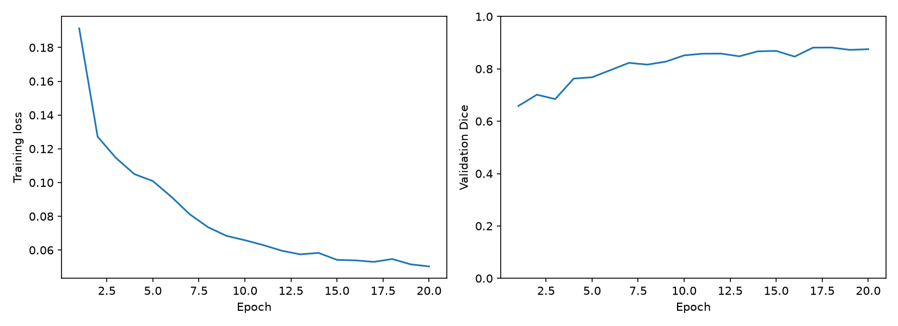
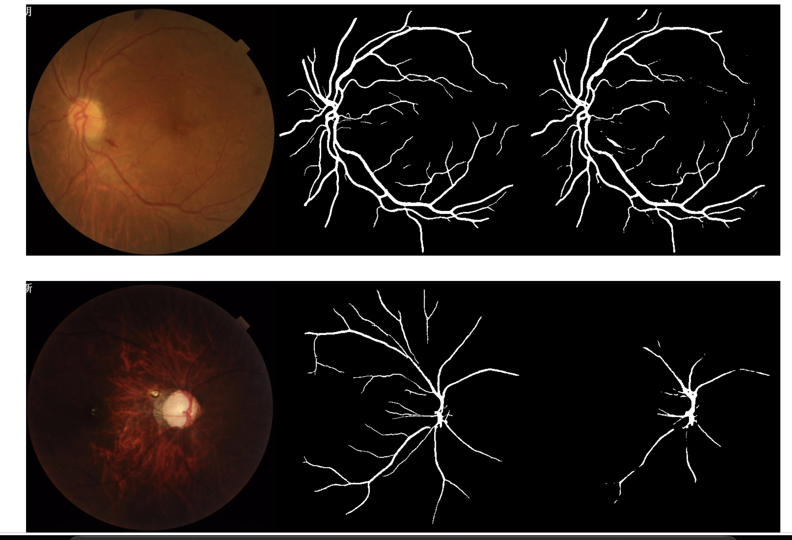
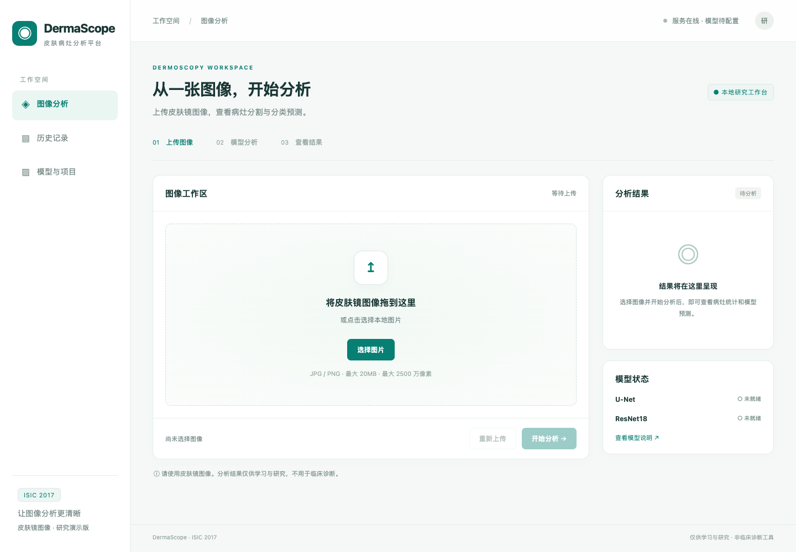
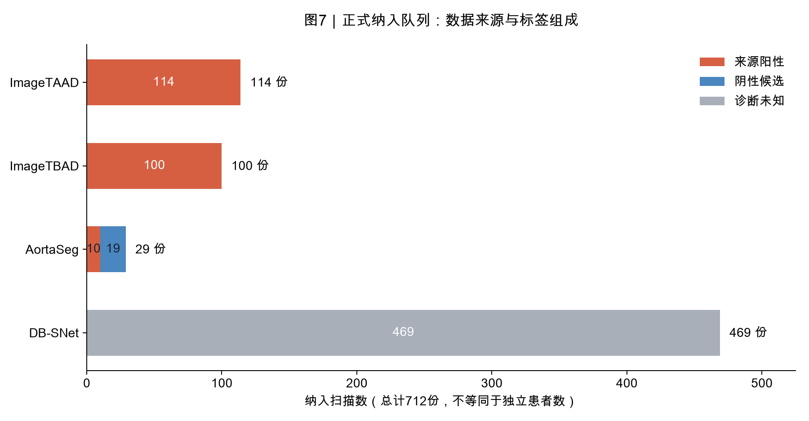
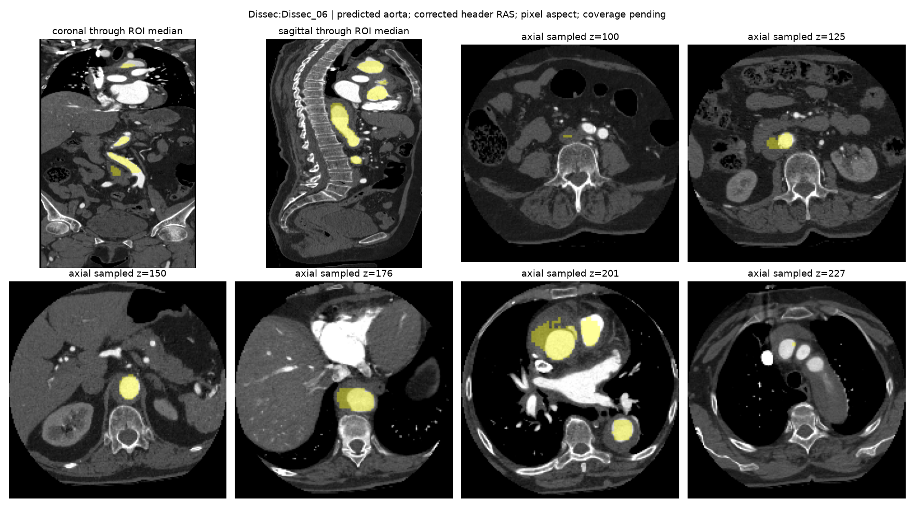
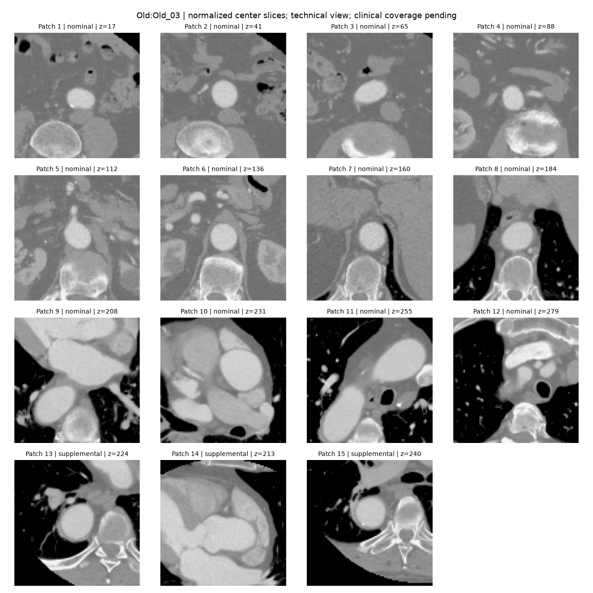
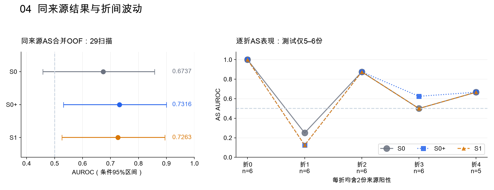

# 工程实践总览

[返回仓库首页](../readme.md) · [科研任务](../research/README.md)

工程实践围绕医学图像分析，将模型训练、评价与网页应用连接起来。目前包含眼底血管分割、皮肤病灶分析平台和 主动脉夹层CTA半监督研究三项实践。

## 项目进度

| 项目 | 当前状态 | 主要交付物 |
| --- | --- | --- |
| FIVES 血管分割 | 已有实验报告与预测示例 | 源码 ZIP、训练曲线、分割结果 |
| ISIC 皮肤病灶平台 | 已有验证结果与平台使用文档 | 源码 ZIP、训练曲线、指标表、混淆矩阵、运行截图 |
| CTA 夹层半监督分类 | 已完成固定五折训练与评估 | 详细报告、数据集与案例配图、逐扫描结果、训练记录、冻结代码及协议 |

## 1. U-Net 在 FIVES 上的眼底血管分割

**项目目标**：通过医学图像分割任务，理解从数据读取到训练、模型选择、测试评估和结果导出的完整流程。

| 项目 | 当前记录 |
| --- | --- |
| 数据集 | FIVES 眼底血管分割数据集 |
| 数据规模 | 数据集训练部分 600 张、测试部分 200 张；训练部分内的验证划分尚待在报告中说明 |
| 图像处理 | 原始尺寸 2048 × 2048，使用 0.25 的缩放比例，输入尺寸 512 × 512 |
| 模型与环境 | U-Net；AutoDL 云 GPU 环境 |
| 已记录内容 | 报告描述了数据预处理、训练、验证模型选择、测试评估与结果导出流程，并提供训练曲线及预测样例 |
| 待补充内容 | 最佳轮次、量化测试指标、训练／验证划分、运行命令及原始日志；当前仅凭报告无法核对测试结论 |

- [源码压缩包](<U-Net 在 FIVES 上的血管分割/UNet源码.zip>)
- [实验报告](<U-Net 在 FIVES 上的血管分割/U-net复现.md>)

**训练曲线**

**分割结果示例**：从左到右为原图、真实标注、模型预测。

## 2. 基于 U-Net 与 ResNet18 的皮肤病灶分析与分类平台

**项目目标**：将病灶分割、三类分类与网页交互结合，实现从图像上传到结果查看、历史查询和导出的应用流程。分割与分类分别处理输入图像、独立推理；当前分类模型不使用分割掩码或病灶 ROI。

### 技术方案与功能

| 层次 | 技术与实现 |
| --- | --- |
| 分割模型 | PyTorch U-Net，输出病灶二值掩码 |
| 分类模型 | ImageNet 预训练 ResNet18，区分黑素细胞痣、黑色素瘤、脂溢性角化病 |
| 后端 | FastAPI、PyTorch、Pillow、NumPy、SQLite |
| 前端 | HTML、CSS、JavaScript，由同一服务提供网页与接口 |
| 推理部署 | 本地 CPU 推理，默认 2 个线程 |

- 上传皮肤镜图像，查看原图、病灶掩码与叠加视图。
- 展示三类预测概率、分割面积占比、图像尺寸和推理耗时。
- 保存分析历史，支持文件名搜索、类别筛选和日期筛选。
- 下载包含原图、掩码、叠加图与 JSON 结果的 ZIP 文件。
- 查看记录详情，打印报告或通过浏览器另存为 PDF。

### 已记录的实验结果

使用 ISIC 2017 官方训练／验证划分，实际训练样本为 1999 张，验证样本为 150 张。官方训练集为 2000 张；分类数据检查记录将 `ISIC_0012970` 标为 `ISIC_0012127` 的重复项并排除，实际使用 1999 张。该记录直接证明分类数据的排除情况。下列指标均来自现有实验报告中的**验证集结果**，不作为独立测试集结果或论文原始指标的复现声明。

| 任务 | 最佳模型选择依据 | 最佳轮次 | 同轮验证结果 |
| --- | --- | ---: | --- |
| U-Net 病灶分割 | 逐图平均 Dice 最大 | 38 | Dice **0.8476**；IoU **0.7645** |
| ResNet18 三类分类 | 宏平均 F1 最大 | 31 | 宏平均 F1 **0.7907**；准确率 **81.33%** |

其中，黑色素瘤验证集共有 30 张，正确识别 18 张，召回率为 **0.60**。后续将重点检查误判样本，并在实验中同时报告各类别表现。

### 项目入口

- [使用文档](基于U-net和ResNet的皮肤病灶分析与分类平台/readme.md)
- [实验报告与详细指标](基于U-net和ResNet的皮肤病灶分析与分类平台/项目实验报告.md)
- [项目源码压缩包](基于U-net和ResNet的皮肤病灶分析与分类平台/基于U-net和ResNet的皮肤病灶分析与分类平台.zip)

源码压缩包的项目根目录为 `isic2017-platform/`。进入该目录，按使用文档建立 Python 环境并运行 `bash start_web.sh`，默认访问 `http://127.0.0.1:8765`。**当前压缩包不含训练权重**；完成模型分析还需配置 `artifacts/segmentation.pth` 和 `artifacts/classification.pth`，具体见使用文档。

该平台用于皮肤镜图像算法展示与研究；现有结果不能证明临床可靠性，预测不能替代临床诊断。

## 3. 主动脉夹层CTA半监督研究

**项目目标**：在相同父模型、监督访问与续训预算下，检验诊断未知 CTA 的教师—学生一致性训练是否优于继续监督训练。

| 项目 | 结果与口径 |
| --- | --- |
| 数据 | 712份扫描：224来源阳性、19阴性候选、469诊断未知；扫描数不等于独立患者数 |
| 模型 | MASS预训练编码器、位置融合与注意力MIL、EMA教师 |
| 训练 | 固定5折，S0每折600步，S0+与S1各400步；15个训练及15个评估阶段完成 |
| 主分析 | AortaSeg 29份OOF扫描；S0 / S0+ / S1 AUROC为0.6737 / 0.7316 / 0.7263 |
| 主比较 | S1−S0+为−0.0053，条件配对95%区间[−0.0737, 0.0632]，尚未得到明确半监督改善证据 |

- [详细报告、真实数据图与案例分析](主动脉夹层CTA半监督研究/项目实验报告.md)
- [项目入口、冻结代码与结果导航](主动脉夹层CTA半监督研究/README.md)
- [原始结果表](主动脉夹层CTA半监督研究/results/metrics.csv)
- [数据集图像与四类案例分析](主动脉夹层CTA半监督研究/项目实验报告.md#74-具体案例从输入阈值到分类结果)

### 数据组成与来源

正式纳入712份扫描，其中来源阳性224份（31.46%）、阴性候选19份（2.67%）、诊断未知469份（65.87%）。这说明未标注诊断的扫描占多数，但可靠阴性很少；有标签扫描中的阳性比例为92.18%，因此需要同时查看敏感度、特异度和同来源结果。

| 数据来源 | 纳入数量与标签 | 实验中的作用 | 真实图像 |
| --- | --- | --- | --- |
| ImageTAAD | 114份，全部来源阳性 | 有标签训练与外层测试；单来源不能评价特异度 | [TAAD_1预览](主动脉夹层CTA半监督研究/figures/taad01_roi.png) |
| ImageTBAD | 100份，全部来源阳性 | 有标签训练与外层测试；单来源不能评价特异度 | [101预览](主动脉夹层CTA半监督研究/figures/tbad101_roi.png) |
| AortaSeg | 29份：10阳性、19阴性候选 | 同来源主评价；每折另用5份验证扫描选择模型与阈值 | [Dissec_06预览](主动脉夹层CTA半监督研究/figures/dissec06_roi.png) |
| DB-SNet | 469份，诊断未知 | S1中的一致性训练抽样池，不用于计算诊断准确率 | [未知扫描预览](主动脉夹层CTA半监督研究/figures/dbexample_roi.png) |

上表中的AortaSeg 29份通过五折产生折外预测；每一折的验证与测试分区互斥，验证5份不是29份之外另加的独立队列。

### 真实CTA图像与模型输入

**怎么看这张图：** 左侧是冠状面和矢状面，其他小图是多个轴位采样位置；黄色为自动预测的主动脉ROI，用于确定输入区域。它没有标注夹层病灶，也不能代表完整病灶覆盖。此例来源标签为阳性，但三个阶段均漏判，说明定位结果与分类结果需要分别评价。

**模型实际看什么：** 这是Old_03的15个输入块中心层，其中12个为名义块、3个为补充块。每个三维块尺寸为32×96×96，图中只展示其中心一层；模型对整块编码，再用注意力MIL聚合扫描分数。Old_03属于来源支持的阴性候选，后续分类变化见下表。

这些图像来自已归档的输入技术预览。归一化显示和黄色ROI用于核对输入，不能作为医生诊断或夹层病灶真值；原预览中的`coverage pending`也不表示后来完成了临床覆盖认证。

### 代表案例解析

| 案例与来源标签 | S1分数 / 本折阈值 | S1表现 | 对照解读 |
| --- | ---: | --- | --- |
| Dissec_02：来源阳性 | 0.666825 / 0.514373 | 正确识别（TP） | 三组均正确，单例不能代表所有阳性 |
| Dissec_06：来源阳性 | 0.409013 / 0.440865 | 漏判（FN） | 三组均漏判，预测ROI存在不保证识别正确 |
| Old_03：阴性候选 | 0.497256 / 0.514373 | 正确排除（TN） | S0+误判为阳性，S1纠正；不同阶段需使用各自验证阈值 |
| Old_02：阴性候选 | 0.952385 / 0.007967 | 误判（FP） | 三组均误判，仍需检查局部聚合、来源偏差和标签依据 |

分数不是校准后的患病概率；表内为四舍五入展示，原始预测依据完整精度分数和阈值。四例是结果后的描述性选择。Old_03的纠正使AortaSeg特异度从15/19变为16/19，但主比较AUROC差异区间仍跨0，不能据此宣称半监督整体有效。

[完整数据图、案例分数与注意力分析](主动脉夹层CTA半监督研究/项目实验报告.md#74-具体案例从输入阈值到分类结果) · [12条案例原始记录](主动脉夹层CTA半监督研究/results/case_examples.csv)

### 整体结果与案例的关系

上图将同来源总体结果与逐折结果并列。S1的OOF AUROC为0.7263，S0+为0.7316，配对差异为−0.0053，95%区间[−0.0737, 0.0632]。案例展示了具体变化，总体分析则说明这些变化尚不足以形成明确改善证据。

本实践使用CTA进行夹层类别实验；平扫CT、其他AAS病变及临床多模态尚未在本实验中验证。详细报告保留来源标签、阴性候选、身份独立性和有限技术QC的解释范围。
