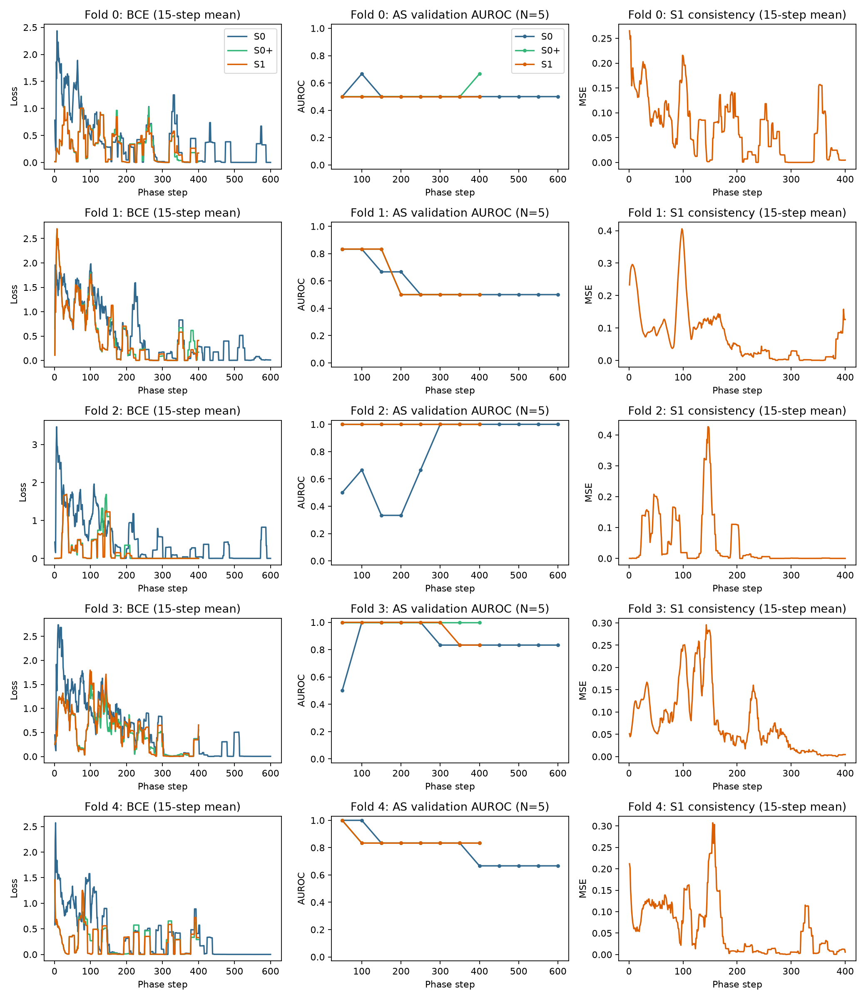

# 公开CTA半监督研究完整实验报告

生成UTC：2026-10-09T19:19:54.752026+00:00。固定5折、15个训练阶段及15个评估阶段均已完成；该报告是本协议的完整探索性实验交付。

## 1. 研究问题与结果概要

研究问题：在相同监督访问和续训预算下，诊断未知CTA的Mean Teacher一致性训练，能否优于继续监督训练？主要比较S1与S0+。MASS外部自监督编码器、注意力MIL聚合及EMA教师共同用于病例分数学习。

主要评估为同来源AortaSeg的29个OOF扫描（阳性10、阴性19）。S1−S0+ AUROC差异=-0.0053，配对95%区间[-0.0737, 0.0632]。配对AUROC差异区间跨越或包含0，本固定协议未得到明确半监督改善证据。 所有数值仅描述该便利样本、既定灰度网格及固定训练协议。

## 2. 数据纳入、标签和有限QC

725份源扫描完成头信息和体素读取审计；排除5份完全相同副本后720候选，保留既有8项暂缓，正式纳入712扫描。最终224来源阳性、19来源支持的阴性候选（训练label=0）、469诊断未知；扫描ID及707个保守划分单位均不能称为已确认独立患者。

| 来源 | 阳性 | 阴性 | 未知 |
| --- | --- | --- | --- |
| ImageTAAD | 114 | 0 | 0 |
| ImageTBAD | 100 | 0 | 0 |
| AortaSeg | 10 | 19 | 0 |
| DB-SNet | 0 | 0 | 469 |
| 合计 | 224 | 19 | 469 |

暂缓：Old01、TAAD2/39/84及4个既有DB条目，具体身份/依据保留excluded_scans.csv；没有根据测试性能选择纳入。正式类别来自canonical已有来源证据，不从图像重新赋诊断。Old/Young的19个阴性候选没有在本任务中逐例由专家确认排除夹层；表格中的阴性仅指冻结标签0，不等同于临床确诊阴性。未知DB始终-1，教师软目标不作为确认诊断。

新TAAD/TBAD150、AS18、DB465共633精确当前绑定，复用旧TAAD62、AS11、TBAD2、DB4的既有精确批准。DB实际5225中心、927补充、430指定块13760深度；新150为2094中心430补充、42块1344深度；AS18为251中心45补充、3块96深度。

QC范围为精确输入、ROI/provenance、预处理/NPZ/PNG快照、稀疏ROI、全部块中心及指定深度，不是每层/每体素、临床全壁或病灶覆盖认证。部分块存在网格外填充、心脏背景、强白器械样环/条纹或有限XY范围，逐例原观察保留；32深度被看不等于32层有完整居中主动脉。未进行新增临床诊断审阅。

## 3. 模型与冻结参数

MASS提供外部掩膜引导自监督预训练编码器。本实验加载mass_base.pth的ema_model编码器、输出512维特征并只微调最后阶段，没有重新执行MASS预训练。[MASS官方实现](https://github.com/Stanford-AIMI/MASS)

每份扫描含多个32×96×96块，块特征结合三维归一化位置，通过softmax注意力加权聚合后分类。注意力是聚合权重，不是病灶标注或因果解释。[注意力MIL原论文](https://proceedings.mlr.press/v80/ilse18a.html)

Mean Teacher学生以BCE及无标签病例软分数MSE反向更新，教师采用EMA α=0.99。教师弱/学生强视图仅灰度增益和噪声不同，几何坐标相同；一致性权重前200续训步由低至0.1，无硬伪标签筛选。[Mean Teacher原论文](https://arxiv.org/abs/1703.01780)

Titan RTX显式float32、AMP关闭、headFP32、chunk32、激活检查点；学习率1e-4、AdamW权重衰减1e-4，编码器last_stage。预处理配置为名义1.5网格、[-991,500]映射范围、ROI zscore、8名义块和覆盖补充上限128。未知原始HU/mm、原生左右或起点没有被恢复，逐例原校准/几何假设仍有效。

## 4. 划分和三组比较约束

按真实来源/类别分层固定5折，外层测试覆盖全部243有标签扫描每阶段各一次；内层AS验证均5例（2阳性/3阴性），用于最佳EMA模型和Youden阈值，其他来源验证不决定模型选择。不同折模型的分数尺度可不同，故同时保留逐折指标。

v4五组：TAAD1/111、120/121、6/118、9/17和DB d9bda0ac/d18b6dfa。同组训练/验证/测试/未知互斥。DB对反向裁剪中央样本相关0.999994、TAAD9/17有限平移最佳相关0.813724，后者仍未决而保守合组；不是确认五个患者，也不是完整独立性审计。

每折S0从原MASS初始化完成600步；S0+/S1分别400步，共7000监督优化步。两延续共享同一AS验证最佳S0快照（匹配student、optimizer、EMA）、种子42+fold、监督访问序列、增强和学习率日程，父EMA原样保留。S0父选择步数可早于600，但S0计算预算全部执行；逐折父SHA和访问相等已实际断言。S1额外未知前向/反向计算另报。

全部15训练阶段结束后才运行15项固定评估，无测试调参、阈值或模型选择。固定预算并不证明充分收敛；未根据最终测试结果延长训练。

## 5. 同来源主要结果

| 组别 | N（阳性/阴性） | OOF AUROC（95% CI） | AUPRC | 敏感度（精确95% CI） | 特异度（精确95% CI） |
| --- | --- | --- | --- | --- | --- |
| S0 | 29 (10/19) | 0.6737 (0.4579–0.8579) | 0.5658 | 0.5000 (0.1871–0.8129) | 0.8421 (0.6042–0.9662) |
| S0+ | 29 (10/19) | 0.7316 (0.5316–0.9000) | 0.6452 | 0.5000 (0.1871–0.8129) | 0.7895 (0.5443–0.9395) |
| S1 | 29 (10/19) | 0.7263 (0.5262–0.8947) | 0.6058 | 0.5000 (0.1871–0.8129) | 0.8421 (0.6042–0.9662) |

| 组别 | 逐折AS AUROC均值 | 逐折AS AUROC样本标准差 |
| --- | --- | --- |
| S0 | 0.6583 | 0.2981 |
| S0+ | 0.6583 | 0.3352 |
| S1 | 0.6333 | 0.3428 |

OOF AUROC区间为10000次类别分层扫描bootstrap；敏感度/特异度为Clopper–Pearson精确区间。区间条件于这些固定OOF预测，没有涵盖重训练、交叉验证模型相关、抽样偏倚或未知患者重叠。AUPRC依赖10/29阳性比例；逐折标准差不是独立训练重复的置信区间。

## 6. 配对比较

| 比较 | AUROC差异 | 配对95% CI | A正确/B错误 | B正确/A错误 | McNemar精确p |
| --- | --- | --- | --- | --- | --- |
| S1 minus S0+ | -0.0053 | -0.0737–0.0632 | 1 | 0 | 1.0000 |
| S0+ minus S0 | 0.0579 | -0.2263–0.3421 | 0 | 1 | 1.0000 |
| S1 minus S0 | 0.0526 | -0.2107–0.3158 | 0 | 0 | 1.0000 |

主要比较为S1−S0+；其余探索性比较未做多重检验调整。同一AS扫描在三组间配对，AUROC差异使用同一bootstrap抽样索引；McNemar检验阈值分类正确性差异，不是AUROC检验。没有把区间跨0误写为两组等效。

## 7. 其他来源与病例记录

| 来源 | 组别 | 阳性数 | 敏感度 | 已知划分单位bootstrap 95% CI |
| --- | --- | --- | --- | --- |
| ImageTAAD | S0 | 114 | 0.9474 | 0.9027/0.9828 |
| ImageTBAD | S0 | 100 | 0.9000 | 0.8400/0.9500 |
| ImageTAAD | S0+ | 114 | 0.9561 | 0.9130/0.9912 |
| ImageTBAD | S0+ | 100 | 0.8400 | 0.7600/0.9100 |
| ImageTAAD | S1 | 114 | 0.9649 | 0.9286/0.9915 |
| ImageTBAD | S1 | 100 | 0.8700 | 0.8000/0.9300 |

ImageTAAD/TBAD只有阳性，不能计算有意义的同来源AUROC或特异度。这里按已有v4保守单位重采样阳性敏感度，不能解决其他未知患者相关；混合243例结果仅次要，见metrics.csv，来源识别和阳性比例混杂可抬高该结果。

逐扫描分数、预测、折、验证阈值、来源/类别依据及聚合权重见out_of_fold_predictions.csv；错误清单见misclassified_cases.csv。分数不视为已校准疾病概率，权重不用于重赋诊断或筛块。DB没有真值诊断指标。

## 8. 真实耗时、显存和失败恢复

| 动作 | 组别 | 记录调用累计分钟 | 本进程峰值分配MiB | 本进程峰值预留MiB | 调用数 |
| --- | --- | --- | --- | --- | --- |
| evaluate | S0 | 3.37 | 4815.7 | 16340.0 | 5 |
| evaluate | S0+ | 3.52 | 4815.7 | 16340.0 | 5 |
| evaluate | S1 | 3.49 | 4815.7 | 16340.0 | 5 |
| train | S0 | 29.09 | 5306.6 | 15582.0 | 5 |
| train | S0+ | 19.86 | 5613.7 | 15870.0 | 5 |
| train | S1 | 37.00 | 5666.6 | 16412.0 | 5 |

时间来自每次phase调用记录，包括该调用预检及模型建立；训练循环时间另由completed.json记录。失败和恢复调用如存在均保留在own_process_resources.csv，不将最终恢复一次耗时冒充总耗时。上述显存来自本进程PyTorch allocator，预留与分配含义不同；整卡显存包含其他任务，不能归属本实验。用户已取消30%显存要求，未进行占位保活或干预其他进程。

完整预处理465项于10月9日06:06:33成功退出，零错误；剩余人工限定QC及同步入账后才开训。同步曾因自动审批等待授权停留381绑定，84本地记录没有虚计；真人明确授权后正常部署/逐块绑定，全部465入账。脚本元数据/路径/标识符/args遮蔽失败、同名查看器保护及修复原记录保留，不改变CT、诊断或缓存，也不改实验预算。

## 9. 训练曲线与解释范围

曲线在每折内分别显示各阶段，不把不同折末尾与下一折起点连成同一曲线。AS内层验证只有5例，AUROC和最佳检查点选择很不稳定；一致性损失降低不等于诊断改善。S1与S0+同监督预算但计算成本不同。

## 10. 局限及结论

配对AUROC差异区间跨越或包含0，本固定协议未得到明确半监督改善证据。 本结果不能确定MASS、MIL或Mean Teacher单独贡献，因为未设置去掉这些模块的独立消融。三者为既有方法，不能将组合直接声称为新算法优势。

- 阴性候选只有19例，来自Old/Young便利来源且没有新增专家确诊排除，缺少真实临床疑似人群的非夹层病变，存在年龄、来源和类别混杂；同来源AS分析也未消除全部偏倚。
- 已排除5个完全副本并设置5个合理保守组，其他同患者/不同裁剪重建及MASS外部预训练重叠仍未知；低相关不证明独立。
- 首版29扫描开发预实验已有查看/训练，S1未观察提升、S0+/S1 BF16同分原因未知；完整队列与开发观察可能重叠，不能宣称完全未触碰的外部测试。
- 探索性灰度/体素网格、腹部/下胸覆盖占比较高及根部/弓覆盖有限，强白/条纹、边缘填充、心脏上下文和局部ROI偏选限制病灶判断。有限技术QC不等于全壁或全体素医学审阅。
- 单组5折种子、短固定步数、极小验证集和无独立外部医院测试不足以确定模型稳定性或临床效用。评估目标仅CTA夹层类别，不代表全部AAS或平扫CT验证。
- 后续需要可靠患者身份、专家诊断、更多独立阴性和外部测试；如研究平扫迁移或临床多模态，应另行取得对应数据和标签。

## 11. 完整交付与可复现性

数据数量/纳入/筛除、冻结配置/划分、逐例OOF/错误、主次指标/配对区间、全部7000步曲线数据及本进程耗时显存随报告交付。原始输入/缓存及训练latest/best仍保留服务器；该报告包不包含CT、NPZ或模型权重，不是完整模型备份。

配置SHA `9abfde13399a265245d6d94f53839f3c3b3bcfe6fecad1128e600112b1ba08c7`；manifestSHA `956ae3bb2dda1979819343c6b1e51f51e9ebba1e86af7da209827af02bd55476`；foldsSHA `10e6ed34345adfdbecf2d68b50e7ac70bbf53e7a32db4aff544aef97a7e5db2c`；原MASS权重SHA `8f27f19e5bd6013f792a2319207d6ec8652229cf4f89d1f29233ff12e9342b32`。完整代码哈希见frozen_protocol.json，逐折父和比较控制保留服务器证据。

- metrics.csv、fold_metrics.csv、paired_comparisons.json：主/次指标与配对分析。
- out_of_fold_predictions.csv、misclassified_cases.csv：729行（三组×243扫描）配对结果。
- frozen_included_scans.csv、excluded_scans.csv、source_counts.csv：712纳入、8暂缓和来源/标签依据。
- training_steps.csv、own_process_resources.csv、time_memory_summary.csv：7000步日志与每次调用资源。
- roc_pr、training_curves、time_memory：PNG及PDF图；frozen_protocol.json、completed_job_snapshot.json、report_proof.json：冻结与完成证据。
