# 第三项实践：主动脉夹层CTA半监督研究

**方法：MASS预训练编码器 + 注意力MIL + Mean Teacher；固定五折对照实验。**

**整理日期：** 2026年10月11日。依据2026年10月10日交付的完整实验与完善版报告整理为仓库第三项实践；未重新训练或改变冻结结果。  
**实验状态：** 5折、15个训练阶段及15个固定评估阶段完成；7000次监督优化步骤。  
**数据范围：** 712份公开来源扫描，其中243份有来源标签、469份诊断未知。  
**用途：** 中文研究汇报与方法复核。所有结果来自已冻结实验；新增内容为方法核对、描述性汇总、图表及解释。

> **核心结论：** 在相同S0父状态、监督访问序列和400步延续预算下，Mean Teacher半监督组S1的同来源OOF AUROC为0.7263，监督续训组S0+为0.7316。差异为−0.0053，条件配对95%区间为[−0.0737, 0.0632]。本实验未得到明确半监督改善证据，亦未证明两组等效。

[项目入口与阅读说明](README.md) · [返回工程总览](../README.md) · [返回仓库首页](../../readme.md)

## 项目定位与阅读导航

本实践“主动脉夹层CTA半监督研究”承接 iAorta 论文阅读与 AAS 研究问题，完成公开 CTA 夹层类别判别的半监督对照实验。与前两项二维分割／分类实践相比，本次增加了三维扫描的多实例表示、来源标签整理、重复扫描控制、教师—学生训练、固定五折评价与计算成本记录。

iAorta 原论文使用平扫 CT，本实践使用 CTA；本次没有复现 iAorta 的完整系统，也没有开展多模态融合、平扫迁移或全部 AAS 亚型分类。报告中的“扫描”是实际文件和评价单位，不能直接解释为已确认独立患者。

- **数据与划分**：第2—3节；图1展示纳入流程，第2.4节含数据组成与四来源真实图像。
- **模型与训练**：第4—5节；图2展示三维块、MIL及共享父模型对照。
- **评价与结果**：第6—8节；图3—4展示ROC/PR和同来源结果，第7.4节含四个具体案例。
- **工程成本与局限**：第9—12节；图5—6展示训练动态与资源。
- **可复核材料**：第13节；CSV、JSON、冻结配置及代码均采用相对路径链接。

## 摘要

**研究目的。** 评估诊断未知CTA的教师—学生一致性学习，在控制额外监督训练的影响后，是否改善公开来源夹层类别判别。

**方法。** 对725份源扫描完成头信息及体素读取审计，去除5份完全相同副本，再排除8项既有暂缓条目，形成712扫描队列：224份来源阳性、19份来源支持的阴性候选、469份诊断未知。使用MASS外部自监督编码器提取三维块特征，结合位置编码及注意力MIL得到扫描级分数。按来源和类别固定5折，并用5个已发现的保守身份组约束分区。每折S0执行600步；S0+/S1从同一验证最佳S0快照分别执行400步，继承匹配的student、AdamW状态与EMA教师。每50步以同来源AortaSeg验证集选择最佳EMA快照；全部训练结束后运行固定评估，阈值由该折验证集确定。

**结果。** 主分析包含29份AortaSeg外层折外预测（out-of-fold，OOF；10阳性、19阴性候选）。S0、S0+、S1的AUROC分别为0.6737、0.7316、0.7263；AP分别为0.5658、0.6452、0.6058。三组在各自验证阈值下均检出5/10来源阳性；S0+与S1分别正确排除15/19及16/19阴性候选。S1−S0+配对AUROC差异区间包含0。S1五折训练调用累计37.00分钟，S0+为19.86分钟，S1约需1.86倍调用时间。正式训练及评估30次调用全部成功，无OOM或正式阶段重启。

**结论。** 固定协议下，增加未知CTA一致性学习没有带来明确的同来源判别改善。阴性数量、年龄与来源混杂、极小验证集、患者与外部预训练重叠未知，以及有限ROI技术核验，限制了统计稳定性与临床推广。该结果描述公开便利样本上的探索性CTA类别实验。

**关键词：** CTA；夹层类别判别；半监督学习；MASS；多实例学习；Mean Teacher；折外预测。

---

## 1. 研究问题、比较对象与解释目标

### 1.1 研究问题

公开CTA的来源诊断标签有限，而三维扫描体积大、局部范围不同。实验将一份扫描表示为若干三维块组成的bag，尝试在少量有标签扫描之外利用诊断未知扫描。

需要回答的具体问题是：**在相同的已训练父模型和监督访问预算下，引入未知扫描的Mean Teacher一致性损失，能否优于单纯继续监督训练？** 因此，主要比较为S1与S0+。S1与S0的差异同时包含继续训练和未知数据计算的影响，作为辅助观察保留。

| 组别 | 初始化与优化 | 监督步骤/折 | 诊断未知扫描 | 研究用途 |
| --- | --- | ---: | --- | --- |
| S0 | 原始MASS预训练编码器；训练MIL头及编码器最后阶段 | 600 | 不进入损失 | 初始监督基线 |
| S0+ | 验证最佳S0的student/optimizer/EMA；监督延续 | 400 | 不进入损失 | 控制额外监督训练的影响 |
| S1 | 与S0+完全相同父状态；监督损失加软分数一致性 | 400 | 每步另抽一份未知扫描 | 检验一致性学习的附加效应 |

两延续共享种子、监督访问、监督增强及学习率日程；S1额外的前向/反向计算计入资源比较。该设计控制了监督访问预算，计算成本仍有差异。

### 1.2 方法来源及本实验角色

| 方法 | 公开方法要点 | 本实验实际使用 | 尚不能单独回答的内容 |
| --- | --- | --- | --- |
| MASS | 自动掩膜构成三维自监督任务，学习可迁移表示 | 加载现成预训练编码器；未重新进行MASS预训练 | MASS相对随机初始化或其他预训练的独立收益 |
| 注意力MIL | 对仅有bag标签的多个实例进行可学习聚合 | 对一份扫描全部块的特征及位置加权聚合 | 相对均值/最大池化的独立收益或病灶定位准确度 |
| Mean Teacher | EMA权重教师提供一致性目标 | 未知扫描同坐标弱/强灰度视图的扫描级软分数MSE | 单独调整EMA、增强或一致性权重的最优效果 |

公开方法依据：[MASS官方实现](https://github.com/Stanford-AIMI/MASS)、[注意力MIL原论文](https://proceedings.mlr.press/v80/ilse18a.html)、[Mean Teacher原论文](https://arxiv.org/abs/1703.01780)。本实验三组均使用MASS与MIL，未开展去除这些模块的独立消融。

## 2. 数据来源、标签形成与纳入流程

### 2.1 数量口径

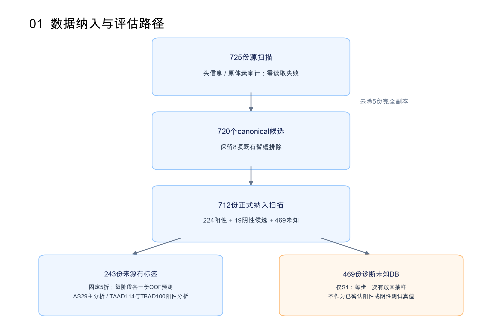

**图1。** 从源文件审计到正式队列的流程。数量单位为扫描；707个保守划分单位也不等于707名已确认独立患者。469未知扫描构成可抽样池，不保证每份均在400次有放回访问中被使用。

725份源扫描经审计均可读取；去除5份完全同体素副本后，得到720个canonical候选。8项既有暂缓保持排除，正式纳入712。以下来源流表由正式纳入清单与暂缓清单复核；不把公开论文所称“病例”直接换算成本实验文件总数。

| 来源 | canonical候选 | 既有暂缓 | 正式纳入 | 阳性 | 阴性候选 | 未知 |
| --- | --- | --- | --- | --- | --- | --- |
| AortaSeg | 30 | 1 | 29 | 10 | 19 | 0 |
| DB-SNet | 473 | 4 | 469 | 0 | 0 | 469 |
| ImageTAAD | 117 | 3 | 114 | 114 | 0 | 0 |
| ImageTBAD | 100 | 0 | 100 | 100 | 0 | 0 |
| 合计 | 720 | 8 | 712 | 224 | 19 | 469 |

### 2.2 标签及公开依据

| 来源 | 本实验标签与数量 | 公开来源依据 | 解释限制 |
| --- | --- | --- | --- |
| ImageTAAD | 114来源阳性，label=1 | 原论文介绍TAAD分割数据；[作者单位论文页面](https://researchportal.hkust.edu.hk/en/publications/domain-knowledge-based-comprehensive-segmentation-of-type-a-aorti/) | 不新增急性状态、临床严重度或患者独立性判断 |
| ImageTBAD | 100来源阳性，label=1 | 提供者介绍100份术前TBAD CTA；[官方仓库](https://github.com/XiaoweiXu/Dataset_Type-B-Aortic-Dissection) | 来源诊断标签用于类别实验；没有重新临床确认 |
| AortaSeg | Dissec10来源阳性；Old/Young19阴性候选，label=0 | [提供者README](https://zenodo.org/records/18147026/files/README.md?download=1) | 正常形态来源标签不等于本任务中新增专家逐例排除夹层 |
| DB-SNet | 469诊断未知，label=−1 | [官方分割项目仓库](https://github.com/yml-bit/DB-SNet)及本实验canonical证据 | 掩膜、目录及图像外观不足以建立当前病例级夹层真值 |

AortaSeg的Young与Old分别为30岁以下及70岁以上来源组，Dissec为未经治疗夹层组。这种类别与年龄的联系可能构成混杂。其自动生成掩膜也可能在复杂病例中不完整或不准确，本实验未把掩膜作为临床全壁或病灶参考标准。[提供者README](https://zenodo.org/records/18147026/files/README.md?download=1)

正式标签从已有canonical来源证据恢复。未知DB在整个实验中保持−1；EMA教师产生的是训练目标分数，未转为确认诊断。有标签扫描的“patient_id”字段是数据集扫描标识，不构成跨来源患者身份认证。

### 2.3 暂缓及技术QC范围

8项暂缓为Old01、TAAD2/39/84及4项既有DB条目。具体身份和当时依据见[暂缓清单](results/excluded_scans.csv)。没有按模型得分、测试表现或影像重新赋予诊断来改变纳入。

技术QC覆盖精确输入身份、已有canonical原体素哈希引用、ROI与预处理provenance、NPZ/PNG快照、稀疏ROI概览、全部块中心及指定块深度。新批准633份（TAAD/TBAD150、AS18、DB465）与复用79份（TAAD62、AS11、TBAD2、DB4）共同形成712份正式清单。

| 新QC批次 | 实际块中心 | 其中补充中心 | 指定深度块 | 实际深度层 |
| --- | ---: | ---: | ---: | ---: |
| TAAD/TBAD150 | 2094 | 430 | 42 | 1344 |
| AortaSeg18 | 251 | 45 | 3 | 96 |
| DB465 | 5225 | 927 | 430 | 13760 |

这些计数描述实际查看范围，中心与指定深度可能包含同一块，不能相加成独立扫描或全体素审阅。部分块保留网格外填充、心脏背景、器械样强白环/条纹或有限XY边缘。查看32个深度位置不等于32层均有完整居中主动脉，ROI覆盖率也不证明临床病灶覆盖。

### 2.4 数据集组成与真实输入样例

**图7。** 根据正式纳入清单绘制。469份诊断未知扫描占65.87%，224份来源阳性占31.46%，19份阴性候选占2.67%。有标签扫描中阳性占224/243=92.18%；训练采用类别平衡抽样不能改变测试来源组成。ImageTAAD和ImageTBAD没有本实验中的阴性对照，不能从它们单独计算特异度。

以下是各来源的真实输入技术预览，按冻结清单的扫描标识、缓存文件名和ROI目录匹配，不是合成CT。黄色区域为输入驱动的**预测主动脉ROI**，不是医生标注的夹层病灶或模型分类解释。图像是经研究预处理后的显示，不能直接比较不同来源的绝对灰度、毫米尺寸或增强程度。预览标题中的 `coverage pending` 是生成快照时保留的状态文字；正式纳入后通过的是有限技术QC，仍未完成临床全壁／病灶覆盖认证。

#### ImageTAAD：TAAD_1，来源阳性

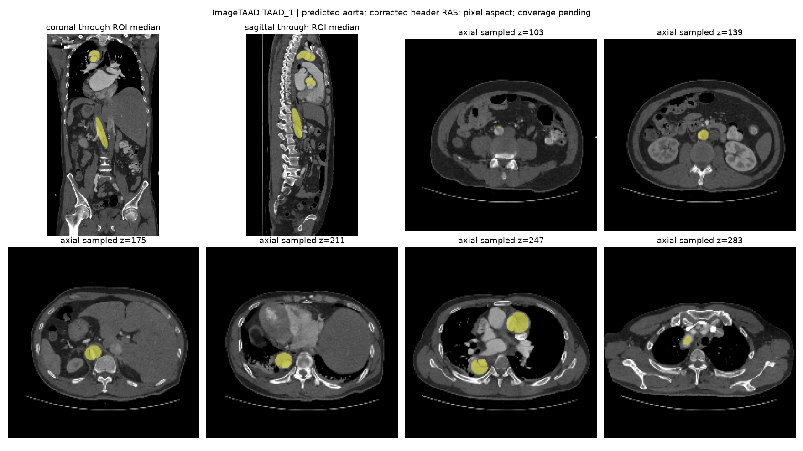

**图8。** 冠状面、矢状面与六个轴位采样位置显示扫描的纵向范围和预测ROI。这里可观察到黄色区域沿多个位置分布，而非所有切面都呈相同形状；因此模型使用多个局部三维块，再由MIL聚合。来源标签依据TAAD数据队列，不从黄色区域重新诊断。本来源共114份阳性；样例只用于展示输入，不能代表所有病例的病变位置或难度。

#### ImageTBAD：101，来源阳性

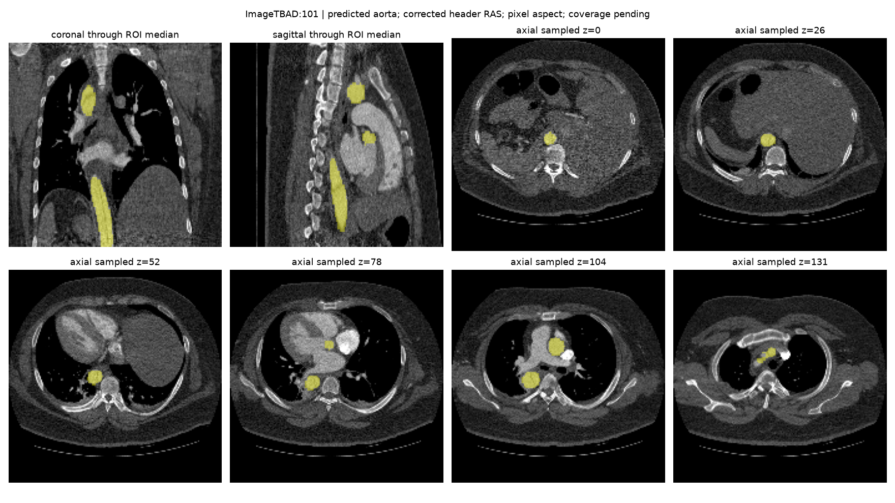

**图9。** 该样例的显示范围、图像背景和噪声外观与上一来源不同，可用于理解多来源输入存在的技术差异。顶部冠状／矢状面提供纵向上下文，轴位小图是稀疏位置，不是连续完整切片。它的来源标签为阳性；本报告不依据这些预览认定夹层真腔、假腔或分型。

#### AortaSeg：Dissec_06，来源阳性

**图10。** 此例同时作为下文阳性漏判案例。黄色ROI出现在腹部、下胸及更高采样位置；ROI存在只说明定位流程产生了区域，不保证后续分类正确。AortaSeg是本实验同时具有阳性与阴性候选的来源，也是主要评价来源；图像仍不代替标签审核。

#### DB-SNet：internal:0039ebfcd4cb01ec，诊断未知

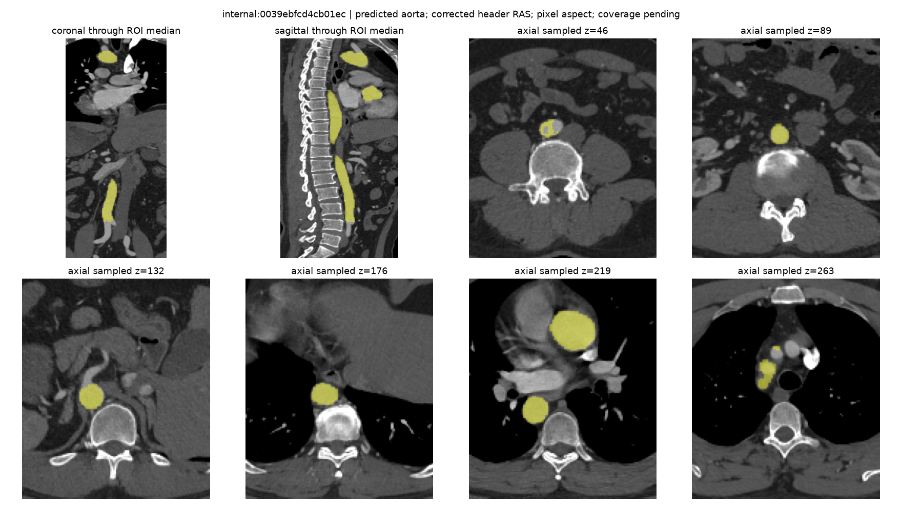

**图11。** 该例具有CTA输入与预测主动脉ROI，但冻结标签仍为−1。图中的亮度或ROI形状不能将其补写为阴性或阳性；它在S1中提供一致性目标，未进入有诊断标签的OOF性能统计。预览用于说明“有影像”与“有可靠扫描级诊断真值”是两件事。

图像来源及文件SHA见[预览溯源记录](results/dataset_preview_provenance.json)。图中扫描名是公开数据与实验标识，不能直接当作跨数据集患者身份。

## 3. 去重、身份组与固定五折

### 3.1 已发现的五个保守同分区组

| 组 | 来源扫描标识 | 处理依据 |
| --- | --- | --- |
| 1 | TAAD1 / TAAD111 | 已完成技术相似性筛查后保守同分区 |
| 2 | TAAD120 / TAAD121 | 已完成技术相似性筛查后保守同分区 |
| 3 | TAAD6 / TAAD118 | 已完成原始层面控制后保守同分区 |
| 4 | TAAD9 / TAAD17 | 有限平移最佳相关0.813724，身份未决；保守合组可能包含不同患者 |
| 5 | DB d9bda0ac / d18b6dfa | 反向Z与裁剪重叠中央样本相关0.999994，强技术来源重叠证据 |

精确成员见[v4身份组](results/protocol/near-duplicate-identity-groups-v4-20261009.json)。有限控制没有完成缩放、旋转或非刚性配准；未重算DB重叠范围全部体素哈希。以上约束处理已发现候选，其他患者/裁剪重建/外部MASS预训练重叠仍未知。低相关不能证明独立。

### 3.2 训练、验证、测试分区

固定来源/类别分层5折，种子基数42。每折有标签扫描分成训练、验证、外层测试；469未知扫描置于单独池，与有标签训练/验证/测试标识互斥。每个保守组在同一折中只进入一个分区。

| 折 | 训练 总（阳/阴） | 验证 总（阳/阴） | 测试 总（阳/阴） | AS测试 阳/阴 | TAAD测试 | TBAD测试 | 未知池 |
| --- | --- | --- | --- | --- | --- | --- | --- |
| 0 | 156（144/12） | 39（36/3） | 48（44/4） | 2/4 | 22 | 20 | 469 |
| 1 | 156（144/12） | 39（36/3） | 48（44/4） | 2/4 | 22 | 20 | 469 |
| 2 | 153（141/12） | 39（36/3） | 51（47/4） | 2/4 | 25 | 20 | 469 |
| 3 | 155（143/12） | 39（36/3） | 49（45/4） | 2/4 | 23 | 20 | 469 |
| 4 | 155（142/13） | 41（38/3） | 47（44/3） | 2/3 | 22 | 20 | 469 |

表中“阳/阴”指冻结来源标签。外层测试合计覆盖243份有标签扫描每阶段各一次。每折AS内层验证均为5份（2阳性、3阴性）；其他来源验证记录保留，但不参与模型和阈值选择。没有沿用源目录的imagesTr/imagesTs作为实验分区。

不同折训练集有重叠，5折的模型并非5个独立重复实验。OOF意味着每份扫描的该阶段分数由本折外层测试模型产生；开发预实验与完整队列的重叠仍使该队列不能被称作完全未触碰的外部测试。

## 4. 输入构建与MASS—MIL模型

### 4.1 三维块及预处理

| 项目 | 冻结配置或实际语义 |
| --- | --- |
| 输入 | 一份扫描为一个可变K的三维块bag；扫描级标签用于整bag损失 |
| 每块尺寸 | 32×96×96，单通道，加载后转float32 |
| 位置 | 每块附3维归一化位置，供MIL头融合 |
| 名义网格 | 配置spacing_xyz=[1.5,1.5,1.5]；逐例原几何假设保留 |
| 灰度范围 | 配置映射范围[−991,500]，随后zscore_roi；不代表所有输入已恢复真实HU |
| 块数量 | 配置patches=8为名义最低采样目标，实际K随范围与覆盖补充而变；补充上限128 |
| ROI来源 | 正式清单记录的外部预训练、输入驱动预测ROI；旧批准预测ROI按精确绑定复用 |
| chunk32 | 编码器一次处理最多32块；全部K仍参与同一次MIL聚合 |

某些来源的原生HU、毫米尺度、方向及起点不完整，研究变换与校准依据逐例记录在[纳入清单](results/frozen_included_scans.csv)。模型处理的是已批准的探索性灰度/体素网格；不能把名义1.5直接解释为所有扫描已获临床物理标定。

### 4.2 编码、位置融合及注意力

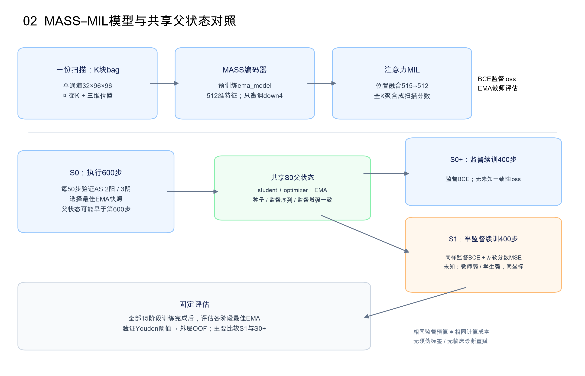

三组 S0、S0+、S1 均在完成训练后进行固定 OOF 评估；图中箭头为流程示意，不能理解为仅对 S1 评估。

**图2。** 每扫描全部块先编码、再融合位置并聚合成一个分数；两延续分支从同一验证最佳S0状态开始。图为冻结实现的流程示意，不是新架构消融或临床定位验证。

本实验使用MASS的三维UNet编码器，通道为32/64/128/256/512，加载mass_base.pth中ema_model的encoder权重。输出经自适应平均池化为512维特征。编码器仅down4最后阶段参与微调，其余编码器参数冻结；位置融合、注意力和分类头参与训练。[冻结模型实现](results/code/cta_ssl/model.py)

设一份扫描的第k块为 \(x_k\)，位置为 \(c_k\in\mathbb{R}^3\)。本实验计算：

$$
h_k=\operatorname{AvgPool}(f_\theta(x_k))\in\mathbb{R}^{512},\qquad
q_k=\operatorname{ReLU}(W_p[h_k;c_k]+b_p).
$$

位置融合线性层为515→512。注意力头为512→64、Tanh、64→1：

$$
e_k=v^\top\tanh(W_aq_k+b_a)+b_e,\quad
a_k=\frac{\exp(e_k)}{\sum_{j=1}^{K}\exp(e_j)},\quad
z=\sum_{k=1}^{K}a_kq_k,\quad
p=\sigma(w^\top z+b).
$$

这里 \(a_k\) 是扫描分数计算中的聚合权重。它不等于病灶概率、分割结果或因果贡献；本实验没有据权重筛块、重赋诊断或认证临床全壁覆盖。

### 4.3 教师、增强与损失

教师参数 \(\phi\) 不接受反向梯度；每次学生AdamW更新后，执行：

$$
\phi_t=0.99\phi_{t-1}+0.01\theta_t.
$$

模型buffer由学生复制到教师。延续初始化时，教师加载父checkpoint中已有teacher状态；没有把父EMA重置为父student。

| 视图 | 灰度乘性增益 | 加性高斯噪声标准差 | 几何位置 |
| --- | --- | ---: | --- |
| 监督及未知弱视图 | 均匀范围约[0.97,1.03] | 0.008 | 保持原块与坐标 |
| 未知强视图 | 均匀范围约[0.92,1.08] | 0.025 | 与弱视图相同 |

增强作用于归一化块，未加入空间旋转、裁剪或左右翻转；噪声幅度的单位是该归一化灰度。增益与噪声随机种子由阶段步数确定，未知分支的随机数消耗不改变监督增强。[冻结数据实现](results/code/cta_ssl/data.py)

监督loss为整份扫描的二元交叉熵；S1另对一份未知扫描的教师弱视图和学生强视图分数计算MSE：

$$
\mathcal L_{sup}=\operatorname{BCEWithLogits}(\ell_\theta(x_l),y_l),\qquad
\mathcal L_{con}=\big[p_\theta(T_s(x_u))-\operatorname{stopgrad}(p_\phi(T_w(x_u)))\big]^2.
$$

$$
\mathcal L_{S1}=\mathcal L_{sup}+\lambda(t)\mathcal L_{con},\qquad
\lambda(t)=0.1\min(1,t/200),\quad t=1,\ldots,400.
$$

S0/S0+使用监督loss；S1使用上式。这里没有硬伪标签、置信度筛选或根据教师分数改写真值标签。三个阶段均以EMA教师做验证及最终预测。

## 5. 优化协议、共享父状态与真实监督预算

### 5.1 固定参数

| 参数 | 实际设置 |
| --- | --- |
| 种子 | 42+fold，即42至46 |
| 优化器 | AdamW；初始lr=1e−4；weight_decay=1e−4 |
| 学习率 | 阶段内余弦下降，最低比例0.1；两个400步延续日程相同 |
| 梯度裁剪 | 全模型梯度范数上限5 |
| 精度 | float32；AMP关闭；MIL头FP32 |
| 显存策略 | 编码器chunk32与激活检查点；无显存占位保活 |
| 初始阶段预算 | 每折S0 600步 |
| 延续阶段预算 | 每折S0+400步、S1 400步 |
| 验证/保存 | 每50步及阶段末；保留latest与AS验证AUROC最佳best |
| 半监督 | EMA=0.99；一致性最大权重0.1；线性ramp200步 |

阶段学习率为：

$$
\eta_s=10^{-4}\left[0.1+0.45\left(1+\cos\frac{\pi s}{T}\right)\right],\quad s=0,\ldots,T-1.
$$

S0的 \(T=600\)，每个延续阶段的 \(T=400\)。AdamW动量等optimizer状态来自所选S0父快照，阶段内学习率和确定性采样从新阶段步0开始。

### 5.2 一步、访问与epoch的区别

每步先以等概率选择标签0或1，再在该类训练扫描中均匀有放回抽取一份扫描。因此，一步对应一个扫描bag的监督loss；监督类别被抽样平衡，而不同来源的阳性比例没有额外平衡。

有标签队列为224阳性、19阴性候选，类别平衡采样意味着少量阴性会被重复访问。400步不是400份新增病例，也不是完整遍历队列的一个epoch。完整固定预算 \(5\times(600+400+400)=7000\) 指监督优化步骤总数。

| 折 | S0访问 阳/阴 | S0唯一/可用 | S0+/S1访问 阳/阴（各） | S0+/S1唯一/可用（各） | S0未访问 | 续训未访问（各） |
| --- | --- | --- | --- | --- | --- | --- |
| 0 | 292/308 | 138/156 | 197/203 | 120/156 | 18 | 36 |
| 1 | 283/317 | 132/156 | 196/204 | 113/156 | 24 | 43 |
| 2 | 304/296 | 139/153 | 202/198 | 122/153 | 14 | 31 |
| 3 | 275/325 | 135/155 | 188/212 | 120/155 | 20 | 35 |
| 4 | 307/293 | 138/155 | 199/201 | 121/155 | 17 | 34 |

表中的唯一访问数仅按各折各阶段监督日志复算；跨折/阶段不能相加为独立患者数。S1每步从469未知池另做一次有放回抽样，五折共2000次未知抽样机会。现有逐步日志只记录labeled_patient，未记录每步unlabeled_patient，因此未把“未知池469份全部被实际访问”当作逐例日志已核实结论。

### 5.3 共享父快照及最佳模型规则

S0执行全部600步计算预算，然后把该阶段**AS验证AUROC最佳**快照作为两延续的共同父状态。父快照可能早于第600步；两延续均加载该快照中匹配的student、optimizer及EMA。

| 折 | 种子 | S0父步 / 验证AUROC | S0+最佳步 / 验证AUROC | S1最佳步 / 验证AUROC |
| --- | --- | --- | --- | --- |
| 0 | 42 | 100 / 0.6667 | 400 / 0.6667 | 50 / 0.5000 |
| 1 | 43 | 50 / 0.8333 | 50 / 0.8333 | 50 / 0.8333 |
| 2 | 44 | 300 / 1.0000 | 50 / 1.0000 | 50 / 1.0000 |
| 3 | 45 | 100 / 1.0000 | 50 / 1.0000 | 50 / 1.0000 |
| 4 | 46 | 50 / 1.0000 | 50 / 1.0000 | 50 / 1.0000 |

各自最佳EMA对应的验证Youden阈值：

| 折 | S0阈值 | S0+阈值 | S1阈值 |
| --- | --- | --- | --- |
| 0 | 0.4433 | 0.9997 | 0.5144 |
| 1 | 0.6007 | 0.4426 | 0.4409 |
| 2 | 0.0113 | 0.0080 | 0.0080 |
| 3 | 0.5424 | 0.6767 | 0.6779 |
| 4 | 0.6139 | 0.4420 | 0.4429 |

例如折0的S1新阶段最佳验证AUROC为0.5000，低于父S0的0.6667；固定选择规则允许这一情况。S0+折0阈值接近1，说明工作点依赖验证集分数尺度，不能当作校准概率。

各阶段最佳值从−1重新比较，只有严格AUROC提升时替换best，同分时保留更早快照。两延续不要求其新阶段最佳验证值超过S0父验证值。表中的最佳步数是该阶段的局部步数，不能当作全部计算预算或额外epoch。

S0+/S1的400条监督扫描序列与学习率逐条相等，且监督序列也等于同折S0前400条序列；访问顺序及监督增强的阶段种子规则保持一致。两延续初始化时的student、EMA和optimizer状态，以及父SHA和监督访问控制均有逐折证据。[父状态和比较证据目录](results/evidence/)

## 6. 评估选择与统计方法

### 6.1 模型选择和阈值

所有15个训练阶段先完成，再对15个固定最佳EMA模型运行评估。每折的AS验证集用于Youden指数 \(J=TPR-FPR\) 最大化阈值；实现只接受有限且位于[0,1]的候选阈值。并列时采用实现返回的第一个最大候选；外层测试结果不参与阈值调整。

测试预测为 \(\widehat y=\mathbb{1}(p\geq\tau_{fold,phase})\)。没有统一强制0.5阈值。分数不是经临床校准的疾病概率；极小验证集可能产生很不稳定的阈值。不同折模型分数尺度也可不同，故同时报告合并OOF结果和逐折结果。

表格中的指标和阈值按展示精度四舍五入；复核分类预测应使用病例CSV中的原精度分数与阈值，不用展示值重新划分病例。

### 6.2 主次终点

| 层级 | 终点/比较 | 原因与解释 |
| --- | --- | --- |
| 主要 | AS同来源OOF AUROC；S1−S0+配对差异 | 减少跨数据源的类别/来源混杂；控制继续监督训练 |
| 补充 | AS AP、敏感度、特异度、混淆矩阵及逐折AUROC | 描述排序与验证阈值下的分类行为 |
| 来源描述 | TAAD/TBAD阳性敏感度 | 两来源无阴性，不能估计同来源特异度或AUROC |
| 次要 | 混合243份来源标签的OOF指标 | 阳性比例及来源混杂强，仅作探索性描述 |
| 资源 | 训练调用时间、本进程allocated/reserved峰值 | S1与S0+监督预算相同但额外计算不同 |

AP采用average_precision定义，即在召回增量上加权精确率；本报告用AP明确原CSV中auprc字段的算法，未把它误当PR曲线梯形积分。AS阳性比例10/29≈34.48%，混合队列224/243≈92.18%；高混合AP必须结合该基线比例理解。

### 6.3 不确定性与配对比较

- AS AUROC及配对差异：10000次类别分层扫描bootstrap，固定分析种子20261010；两组使用相同重抽样索引。
- 敏感度/特异度：Clopper–Pearson精确二项区间。
- TAAD/TBAD阳性敏感度补充区间：按已知v4划分单位重抽样；未发现的患者相关不能由此消除。
- McNemar：检验配对阈值分类正确性的变化；它不是AUROC差异检验。辅助比较未作多重检验校正。

这些区间**条件于已生成的OOF预测和验证阈值**，未覆盖重训练、模型相关性、未知患者/预训练重叠、抽样偏倚或标签误差。区间包含0表示现有数据未给出明确差异证据，不能推断效果为零、等效或达到临床非劣效。

## 7. 同来源主要结果

### 7.1 合并OOF指标

| 组别 | AUROC | 条件95%区间 | AP | 敏感度 | 特异度 | 平衡准确率 |
| --- | --- | --- | --- | --- | --- | --- |
| S0 | 0.6737 | [0.4579, 0.8579] | 0.5658 | 50.00% | 84.21% | 67.11% |
| S0+ | 0.7316 | [0.5316, 0.9000] | 0.6452 | 50.00% | 78.95% | 64.47% |
| S1 | 0.7263 | [0.5262, 0.8947] | 0.6058 | 50.00% | 84.21% | 67.11% |

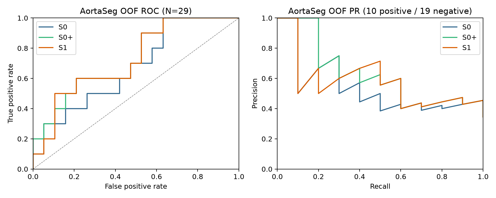

**图3。** AS29固定OOF分数的ROC与PR；阳性10、阴性候选19。图形中的线段只是本队列排序表现，不反映独立临床人群的预期曲线。

| 组别 | TP | FN | TN | FP | 敏感度精确95%区间 | 特异度精确95%区间 |
| --- | --- | --- | --- | --- | --- | --- |
| S0 | 5 | 5 | 16 | 3 | [0.1871, 0.8129] | [0.6042, 0.9662] |
| S0+ | 5 | 5 | 15 | 4 | [0.1871, 0.8129] | [0.5443, 0.9395] |
| S1 | 5 | 5 | 16 | 3 | [0.1871, 0.8129] | [0.6042, 0.9662] |

三组均有5/10来源阳性被判为阳性。S1相对S0+正确排除的阴性候选多1份，但排序AUROC略低。阈值正确性与整体排序衡量不同，所以这两个观察可以同时成立。

### 7.2 主配对效果与逐折稳定性

| 比较（前组−后组） | 层级 | AUROC差异 | 配对条件95%区间 | 仅前组正确/仅后组正确 | McNemar精确p |
| --- | --- | --- | --- | --- | --- |
| S1 − S0+ | 主要 | -0.0053 | [-0.0737, 0.0632] | 1/0 | 1.0000 |
| S0+ − S0 | 辅助 | +0.0579 | [-0.2263, 0.3421] | 0/1 | 1.0000 |
| S1 − S0 | 辅助 | +0.0526 | [-0.2107, 0.3158] | 0/0 | 1.0000 |

各图配色以各自图例为准；组别名称 S0、S0+、S1 保持一致。

**图4。** 左侧为AS OOF AUROC及其条件bootstrap区间；右侧为每折AS AUROC。每折测试仅5–6份、阳性2份，个别病例排序变化即可造成明显波动。右侧不是5次独立重训练分布。

| 折 | AS测试 阳/阴 | S0 AUROC | S0+ AUROC | S1 AUROC | 敏感度 S0/S0+/S1 | 特异度 S0/S0+/S1 |
| --- | --- | --- | --- | --- | --- | --- |
| 0 | 2/4 | 1.0000 | 1.0000 | 1.0000 | 100.00% / 100.00% / 100.00% | 100.00% / 75.00% / 100.00% |
| 1 | 2/4 | 0.2500 | 0.1250 | 0.1250 | 0.00% / 0.00% / 0.00% | 100.00% / 100.00% / 100.00% |
| 2 | 2/4 | 0.8750 | 0.8750 | 0.8750 | 100.00% / 100.00% / 100.00% | 50.00% / 50.00% / 50.00% |
| 3 | 2/4 | 0.5000 | 0.6250 | 0.5000 | 50.00% / 50.00% / 50.00% | 75.00% / 75.00% / 75.00% |
| 4 | 2/3 | 0.6667 | 0.6667 | 0.6667 | 0.00% / 0.00% / 0.00% | 100.00% / 100.00% / 100.00% |

逐折AS AUROC均值±样本标准差：S0为0.6583±0.2981，S0+为0.6583±0.3352，S1为0.6333±0.3428。折1三组表现偏低，折0三组AUROC均为1.0。该异质性与小测试集和模型选择不稳定一致，但不足以确认某一来源、ROI问题或病理类型导致了单折结果。

### 7.3 病例配对变化

| 来源 | 扫描数 | 两组都正确 | 两组都错误 | 仅S1正确 | 仅S0+正确 |
| --- | --- | --- | --- | --- | --- |
| AortaSeg | 29 | 20 | 8 | 1 | 0 |
| ImageTAAD | 114 | 109 | 4 | 1 | 0 |
| ImageTBAD | 100 | 82 | 11 | 5 | 2 |
| all_labeled | 243 | 211 | 23 | 7 | 2 |

S1与S0+在AS的29份阈值预测中只有1份分类改变，来自label0候选；S1正确、S0+错误。其余28份分类一致，因此McNemar的有效不一致数只有1，精确p=1。这个p值不表示两组已被证明相同，也不能抵消AUROC配对区间的宽度。

病例分数、折、验证阈值、标签依据和聚合权重见[OOF病例CSV](results/out_of_fold_predictions.csv)，错误记录见[错误病例CSV](results/misclassified_cases.csv)。本次新增解释没有改变病例诊断、阈值、模型或纳入。

### 7.4 具体案例：从输入、阈值到分类结果

选取四份AortaSeg扫描解释正确识别、漏判、误判纠正与持续误判，属于查看冻结结果后的**描述性案例选择**，不新增诊断或推断机制，也不替代全队列统计。所有分数来自该扫描的外层测试折；同一折三阶段的阈值各自由相应阶段验证集确定。分数是模型输出，不是经校准的患病概率。下表为展示值，精确数值与权重见[案例原始表](results/case_examples.csv)。

#### 案例一：Dissec_02——三组均识别的来源阳性

扫描标识 `Dissec:Dissec_02`，外层测试fold 0，来源标签1（AortaSeg Dissec来源）。

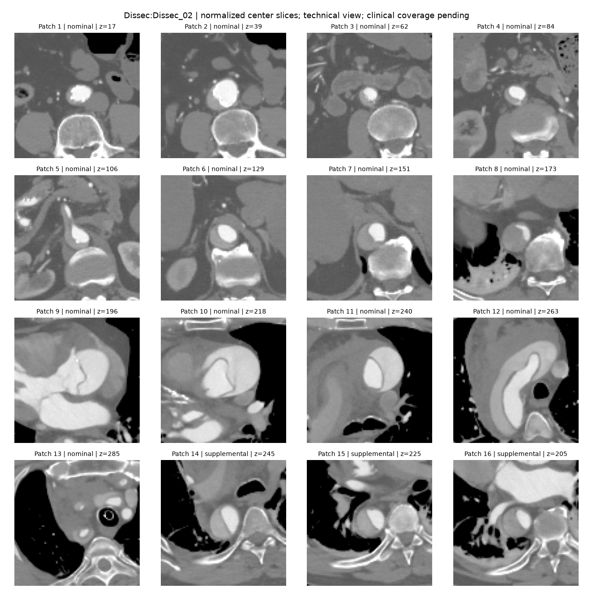

**图12。** 16个输入块的中心层，包含13个名义块和3个补充块。小图从不同纵向位置取样；一个中心层只是32层体块中的一层，不能代表整块或完整主动脉。

| 组别 | OOF分数 | 本折验证阈值 | 预测 | 与来源标签比较 |
| --- | ---: | ---: | --- | --- |
| S0 | 0.47433850 | 0.44328001 | 阳性 | TP |
| S0+ | 0.99993134 | 0.99971384 | 阳性 | TP |
| S1 | 0.66682523 | 0.51437277 | 阳性 | TP |

三组分数均高于各自阈值，因此此例为TP。图中多个块提供不同位置的上下文，S1注意力最高的三个块为15、16、14，合计约54.52%；只能说明这些块在聚合中权重较高，不能据此认定模型找到了夹层病灶。此例支持“这一扫描在固定工作点识别正确”，不支持对全部来源阳性的普遍结论。

#### 案例二：Dissec_06——ROI存在，但三组仍漏判

扫描标识 `Dissec:Dissec_06`，外层测试fold 1，来源标签1。其ROI预览见图10。

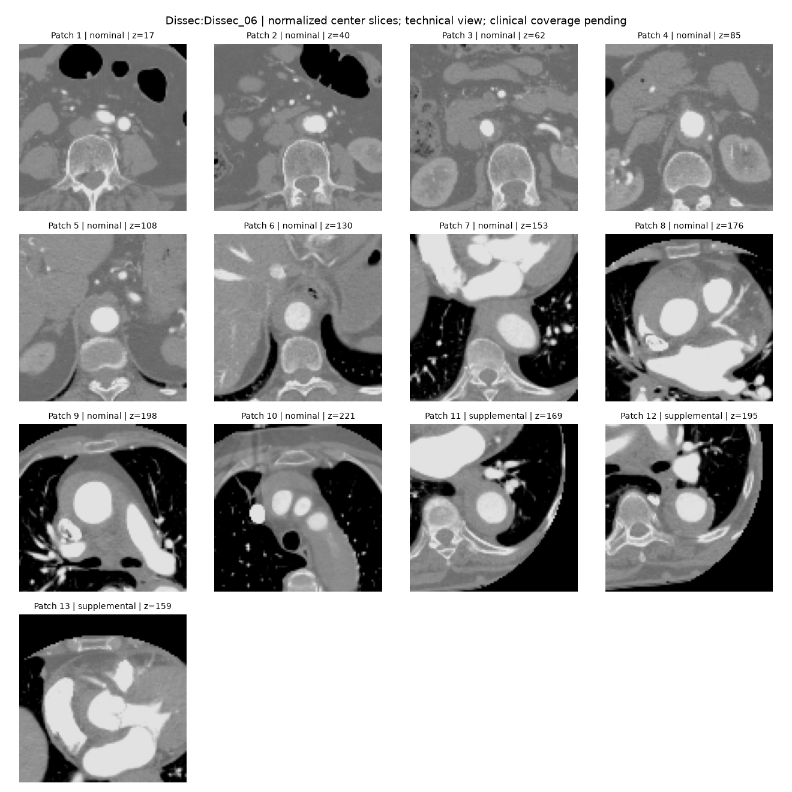

**图13。** 13个块的中心层，包含10个名义块和3个补充块。对照图10可以理解：输入图像中的预测ROI会转为多个局部体块，但“定位到主动脉附近”与“分类为夹层阳性”并非同一任务。

| 组别 | OOF分数 | 本折验证阈值 | 预测 | 与来源标签比较 |
| --- | ---: | ---: | --- | --- |
| S0 | 0.58994174 | 0.60066521 | 阴性 | FN |
| S0+ | 0.41015440 | 0.44258112 | 阴性 | FN |
| S1 | 0.40901253 | 0.44086453 | 阴性 | FN |

三个阶段均为FN。S1分数约0.4090，低于本折阈值约0.4409；即使采用统一0.5阈值仍会漏判，但评价以原验证阈值为准。S1最高单块权重仅约8.17%，前三块合计约24.31%，说明该扫描聚合权重较分散；当前没有因果对照，不能说“分散导致漏判”。可进一步核对该例完整体数据、块覆盖和标签质量，但本报告不把任何一种可能原因当作已证实解释。

#### 案例三：Old_03——S0+误判，S1纠正

扫描标识 `Old:Old_03`，外层测试fold 0，来源标签0（Old来源支持的阴性候选；未新增专家逐例确认排除夹层）。

**图14。** 15个输入块中心层，包括12个名义块和3个补充块。图中有腹部、下胸和较高位置的局部上下文。不能因为分数较高而把这个来源标签0的例子重新诊断为夹层。

| 组别 | OOF分数 | 本折验证阈值 | 预测 | 与来源标签比较 |
| --- | ---: | ---: | --- | --- |
| S0 | 0.41527426 | 0.44328001 | 阴性 | TN |
| S0+ | 0.99993074 | 0.99971384 | 阳性 | FP |
| S1 | 0.49725592 | 0.51437277 | 阴性 | TN |

S0+分数0.99993074，仅比其验证阈值0.99971384高约0.00021690，因而为FP；S1分数0.49725592低于阈值0.51437277，为TN。不同阶段分数尺度变化很大，不能把分数降低直接解释为病情或置信度改善，也不能用统一0.5替代冻结的阈值。

S0+第15和13块的聚合权重合计约98.33%，S1对应两块约53.82%，聚合分布与分类结果同时改变。此例是主配对比较中S1正确而S0+错误的一个扫描，带来1/19的特异度差异；但主要AUROC差异区间仍跨0，不能靠这个案例宣布半监督整体有效。

#### 案例四：Old_02——三个阶段持续误判的阴性候选

扫描标识 `Old:Old_02`，外层测试fold 2，来源标签0。显示ROI和扫描上下文如下。

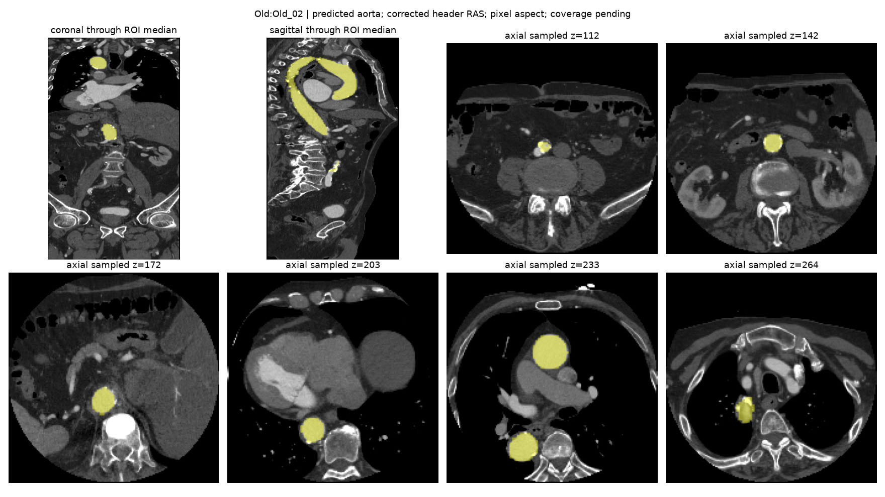

**图15。** 多位置预测ROI预览。该图没有夹层病灶真值；不能从黄色区域或分类阳性结果推断来源标签错误。

| 组别 | OOF分数 | 本折验证阈值 | 预测 | 与来源标签比较 |
| --- | ---: | ---: | --- | --- |
| S0 | 0.97668910 | 0.01130040 | 阳性 | FP |
| S0+ | 0.95381397 | 0.00801469 | 阳性 | FP |
| S1 | 0.95238531 | 0.00796705 | 阳性 | FP |

三个阶段都输出FP。S1分数约0.9524，而其验证阈值约0.0080；不同于Old_03，这是明显高于阈值的持续误判。fold 2的阈值很低，反映仅5份AS验证扫描和本折分数尺度下的工作点；不能移植为全队列通用阈值。S1聚合权重前三块13、12、14合计约92.78%，说明模型高度依赖部分块，但不能确定是年龄、图像来源、背景或主动脉外观中的哪种因素导致误判，需要另设干预或消融实验。

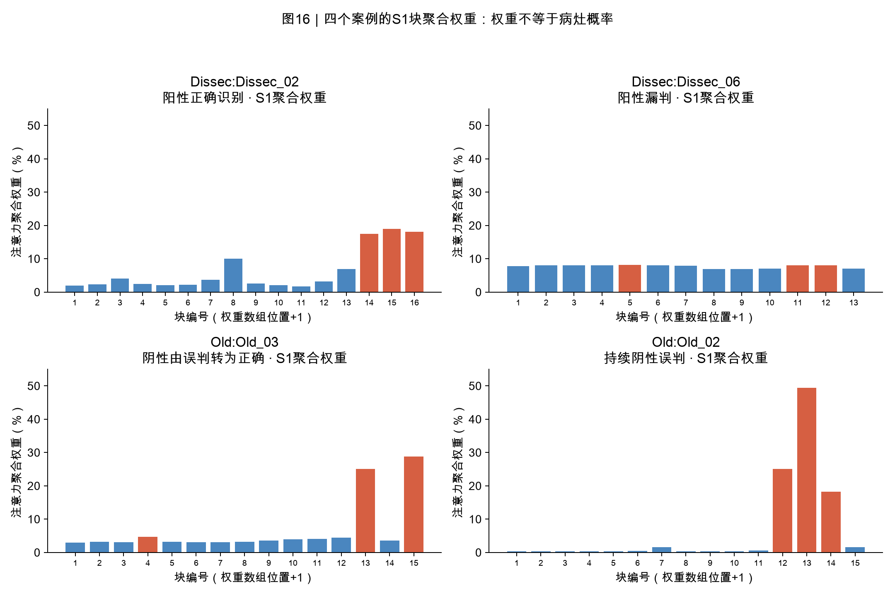

**图16。** 直接由四份扫描的S1权重数组绘制，红色为各扫描权重最高的三块。横轴是数组顺序加1，与对应patch预览编号一致；权重是MIL聚合系数，不是病灶概率、医生标注或Grad-CAM。

四例共同说明：正确案例不能替代总体结果；漏判与误判需要同时分析；验证阈值与分数尺度影响工作点；注意力只能辅助核对模型使用的输入，不能独立建立临床解释。本次增加的病例分析未修改标签、阈值、纳入队列或训练结果。

## 8. 分来源结果与混合队列

| 来源 | 组别 | 检出/来源阳性 | 敏感度 | 划分单位bootstrap95%区间 | 扫描二项精确95%区间 |
| --- | --- | --- | --- | --- | --- |
| ImageTAAD | S0 | 108/114 | 94.74% | [0.9027, 0.9828] | [0.8890, 0.9804] |
| ImageTAAD | S0+ | 109/114 | 95.61% | [0.9130, 0.9912] | [0.9006, 0.9856] |
| ImageTAAD | S1 | 110/114 | 96.49% | [0.9286, 0.9915] | [0.9126, 0.9904] |
| ImageTBAD | S0 | 90/100 | 90.00% | [0.8400, 0.9500] | [0.8238, 0.9510] |
| ImageTBAD | S0+ | 84/100 | 84.00% | [0.7600, 0.9100] | [0.7532, 0.9057] |
| ImageTBAD | S1 | 87/100 | 87.00% | [0.8000, 0.9300] | [0.7880, 0.9289] |

S1的TAAD来源敏感度较S0+高1份扫描（110对109），TBAD高3份（87对84）。这些阳性检出描述没有独立阴性对照，不能推导TAAD/TBAD的完整诊断性能，也不能用来取代AS主要比较。

| 混合243份 | AUROC | AP | 敏感度 | 特异度 | TP/TN/FP/FN |
| --- | --- | --- | --- | --- | --- |
| S0 | 0.7561 | 0.9723 | 90.62% | 84.21% | 203/16/3/21 |
| S0+ | 0.8322 | 0.9774 | 88.39% | 78.95% | 198/15/4/26 |
| S1 | 0.8372 | 0.9805 | 90.18% | 84.21% | 202/16/3/22 |

混合队列中S1 AUROC为0.8372、S0+为0.8322，但阴性全部来自AS，TAAD/TBAD全部为阳性。来源、年龄、范围和增强差异可能形成捷径。混合结果没有推翻同来源主比较未见明确改善的结论。

## 9. 训练动态与计算成本

### 9.1 曲线及可支持的解释

[查看训练曲线原图](figures/training_curves.png)：五折面板较密，可打开原图放大。

**图5。** 每折分列监督BCE的15步滚动均值、5份AS验证AUROC和S1一致性MSE的15步滚动均值；横轴为各阶段局部步数。不同折/阶段未串接成一条训练曲线。

监督损失在多折后段较低，但验证AUROC并不随loss单调改善，部分折长期接近0.5或出现阶跃。AS验证只有2阳性/3阴性，AUROC变化粒度很粗，最佳快照常出现在阶段早期。训练loss下降可反映重复训练扫描的拟合，不能作为充分泛化或收敛证据。

S1一致性MSE在若干折后段降低，仅说明给定未知视图下学生与教师软分数更接近；它不直接测量夹层真值正确率。当前没有未知病例专家真值，也没有输出校准或坍缩诊断实验，所以本报告不把一致性降低归因于临床识别改善或某一确定故障。

### 9.2 真实耗时与本进程显存

| 阶段 | 五折监督步骤 | 训练调用累计 min | 训练loop累计 min | 固定评估累计 min | 训练峰值allocated MiB | 训练峰值reserved MiB |
| --- | --- | --- | --- | --- | --- | --- |
| S0 | 3000 | 29.09 | 27.50 | 3.37 | 5306.6 | 15582 |
| S0+ | 2000 | 19.86 | 18.14 | 3.52 | 5613.7 | 15870 |
| S1 | 2000 | 37.00 | 35.19 | 3.49 | 5666.6 | 16412 |

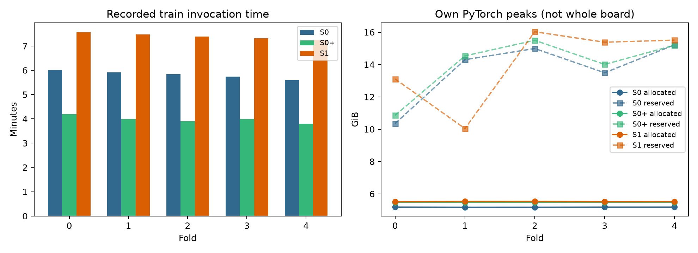

**图6。** 每折记录调用分钟与PyTorch本进程allocated/reserved峰值。reserved是缓存分配器预留，allocated是实际Tensor分配，均不同于整卡含其他进程的读数。

S1/S0+训练调用累计时间比为**1.86**，额外约**17.14分钟**；训练loop时间比为1.94。此处包含教师/学生未知视图计算的差别，也包含实际调用环境；未把时间比作为硬件无关复杂度或独立性能增益。

正式训练到最后评估的墙钟时间为约102.14分钟（10月10日01:35:02至03:17:10，北京时间）。phase调用累计时间包含本次调用的预检、模型建立及执行；训练loop时间来自completed.json；墙钟还包含supervisor与子进程启动等间隔。不同口径分别保留，未把某一训练loop时间当作全部实验耗时。

硬件为Titan RTX 24GiB、计算能力7.5；正式训练使用FP32，未声称原生BF16支持或AMP性能改善。容器资源约12GiB RAM、8 CPU。整卡另有其他任务；本实验没有干预他人进程或执行显存占位保活。

### 9.3 失败、恢复与完整性

正式15次训练和15次评估全部退出0，资源记录显示OOM/oom_kill均为0，正式阶段没有失败恢复调用。训练latest/best及逐折父状态仍保留在原实验服务器。

此前预处理成功队列于10月9日06:06:33完成465份，后续人工限定QC与同步入账完成后才正式开训。同步曾因自动审批停留381份已绑定，84份本地已看记录没有提前入账；明确授权后按原路径同步与身份绑定通过。历史元数据、路径及参数遮蔽等脚本错误已保留修复证据，不能计作正式模型失败或追加训练预算。

本地原始交付包129个索引文件、20个原报告文件SHA核对通过；729条预测、7000步序列、来源标签、固定分区、五折父/EMA/监督访问与资源记录有独立核验。完善版保留原结果文件并为新增内容生成单独索引。

## 10. 结果讨论：事实、假设及后续验证

### 10.1 能直接支持的结论

1. **本协议未显示明确的半监督收益。** 主比较S1−S0+为−0.0053，条件区间跨0；AP也低于S0+。阈值下多排除1份阴性候选没有形成明确配对改善证据。
2. **额外计算确实增加。** S1与S0+有相同监督访问，S1调用时间约1.86倍；在本实验成本下未获得相应主终点收益。
3. **结果对折和验证选择敏感。** 每折AS测试5–6份、验证5份，AUROC、阈值与最佳步数明显波动；单次固定5折不足以建立稳定效能。
4. **来源单侧阳性表现高不能替代同来源验证。** TAAD/TBAD敏感度和混合AUROC仅支持来源队列上的描述，不证明跨来源临床诊断能力。

### 10.2 可能解释与证据边界

| 可能因素 | 当前已有观察 | 目前无法确定的内容 | 另行验证方式 |
| --- | --- | --- | --- |
| 阴性样本少、反复采样 | 19阴性候选、类平衡有放回采样、局部低训练loss | 是否主要导致泛化损失或阈值过拟合 | 新增独立来源阴性及锁定外部测试 |
| 未知池与有标签池分布差异 | DB诊断未知，范围/灰度/ROI上下文存在差异 | 差异的定量强度及对一致性损失的因果影响 | 事先规定范围/来源分析与独立域适配研究 |
| 验证集太小 | 每折AS仅2阳性/3阴性，最佳步数与阈值波动 | 更大验证集是否改变结论 | 在新训练集上固定规则，用新外部数据检验 |
| 一致性任务不足以补充病灶信息 | 仅同坐标灰度增益/噪声、扫描分数MSE | 更强增强、块级目标或权重是否更好 | 独立训练/验证上预设消融，保留新的测试集 |
| ROI与病灶范围不足 | 部分块心脏背景、边界填充、根部/弓覆盖有限 | 哪些特征对分类错误负责 | 专家标注病灶/范围与输入覆盖审阅 |
| 外部表示与训练预算 | MASS仅last_stage微调、固定短步数 | 随机初始化、全量微调或长期训练的效应 | 新协议中的对照及独立学习曲线实验 |

表中后续验证均为建议，未在当前测试数据上执行或用于选择当前报告模型。已有结果不足以把负结果归因于单一技术原因；未依据本轮测试延长训练或调节阈值/权重。

## 11. 研究局限及适用范围

### 11.1 标签与抽样

仅19份阴性候选，且未新增专家逐例确认排除夹层；缺少临床疑似患者中其他非夹层病变的代表性阴性。Old/Young年龄极端组、便利公开来源与阳性来源不平衡，使谱系与来源混杂明显。即便使用同来源AS主分析，年龄和便利抽样偏倚也仍存在。

### 11.2 独立性与开发数据重叠

已删除完全副本并设置5个保守组，但无法证明其他不同采集/裁剪重建、跨来源患者或MASS预训练无重叠。首版29份开发预实验已有查看和训练，完整队列可能与开发观察重叠；本研究具有固定外层测试分区，同时不能被描述为独立未触碰的外部验证。未知患者重叠也会使条件bootstrap区间低估实际不确定性。

### 11.3 物理标定与有限技术QC

部分输入缺少可靠原生HU/mm/方向信息；逐例探索性校准与网格变换不能恢复全部DICOM物理坐标。稀疏ROI、中心和指定深度技术审阅没有确认所有层面/体素或临床全壁、病灶覆盖。真实高密度、条纹、填充和有限范围保留，并可能影响模型。

### 11.4 方法及统计

仅一套固定5折/种子与短步数预算，没有多次独立重训练、系统消融、外部医院队列或预先定义临床工作点。验证极小，合并OOF存在折间尺度差异，区间条件于固定预测；AP依赖阳性比例，McNemar有效不一致数极少。没有评价概率校准、临床决策净获益或病灶定位准确性。

### 11.5 任务覆盖

该实验使用CTA图像及来源夹层类别，不包含临床文本、人口学特征或其他多模态融合实验，也未验证平扫CT迁移。它不覆盖全部急性主动脉综合征（AAS）类别，更不构成临床诊断系统效用的证明。

## 12. 结论

本研究完成了公开CTA来源扫描的canonical去重、有限输入技术QC、已发现身份组的保守分区及固定五折MASS—MIL—Mean Teacher实验。共享父状态、相同监督访问与续训预算的S1/S0+对照，通过逐折证据核实；全部训练和评估按冻结协议完成。

**在本便利队列及固定协议下，诊断未知CTA的一致性学习没有得到明确的同来源判别改善证据。** S1主AUROC略低于S0+，不确定区间跨0，计算时间增加。结果应作为有明确约束与局限的探索性研究记录，后续优先补齐可靠标签、独立患者身份、更多阴性和外部测试，再在新协议中检验方法改进。

## 13. 可复现材料与文件导航

| 材料 | 路径 | 作用 |
| --- | --- | --- |
| 完整中文原报告 | [原始完整报告](results/CTA半监督完整研究报告.md) | 原冻结结果的原始交付 |
| 主次指标 | [metrics.csv](results/metrics.csv)、[fold_metrics.csv](results/fold_metrics.csv)、[paired_comparisons.json](results/paired_comparisons.json) | 主次指标、逐折阈值、配对区间 |
| 病例与错误 | [OOF预测](results/out_of_fold_predictions.csv)、[错误病例](results/misclassified_cases.csv) | 三组×243份=729条结果及标签依据 |
| 纳入与暂缓 | [正式清单](results/frozen_included_scans.csv)、[暂缓清单](results/excluded_scans.csv) | 数量、来源/标签、校准/几何与缓存依据 |
| 冻结协议 | [配置](results/protocol/full-study-titan24-v4-frozen-20261010.yaml)、[划分](results/protocol/full-folds-canonical-v4-20261010.json)、[v4组](results/protocol/near-duplicate-identity-groups-v4-20261009.json) | 固定参数、扫描分区和身份约束 |
| 训练与资源 | [7000步记录](results/training_steps.csv)、[调用资源](results/own_process_resources.csv)、[时间显存汇总](results/time_memory_summary.csv) | 真实预算、计算成本及OOM记录 |
| 运行证据 | [证据目录](results/evidence/)、[冻结证明](results/frozen_protocol.json) | 逐阶段run/completed/invocation及逐折父比较 |
| 完善版派生描述 | [derived-results.json](derived-results.json) | 来源流、分区组成、访问、阈值及资源描述 |
| 真实图像与案例 | [预览溯源](results/dataset_preview_provenance.json)、[案例表](results/case_examples.csv) | 输入预览来源、SHA与四例精确分数、阈值和权重 |
| 本实践交付完整性 | [文件清单.json](文件清单.json) | 本目录实际文件大小/SHA及原报告来源 |

| 冻结对象 | SHA-256 |
| --- | --- |
| 配置 | `9abfde13399a265245d6d94f53839f3c3b3bcfe6fecad1128e600112b1ba08c7` |
| canonical正式清单 | `956ae3bb2dda1979819343c6b1e51f51e9ebba1e86af7da209827af02bd55476` |
| 固定五折 | `10e6ed34345adfdbecf2d68b50e7ac70bbf53e7a32db4aff544aef97a7e5db2c` |
| v4保守组 | `a37d0466ef9e56c62cd3dfe172518fb899d311ea698326ec18e1c7159e2637de` |
| MASS原预训练权重（包内不含权重） | `8f27f19e5bd6013f792a2319207d6ec8652229cf4f89d1f29233ff12e9342b32` |

报告包不包含CT、NPZ或模型权重；原输入、缓存、latest/best仍保留在已授权实验服务器。交付代码包括冻结关键运行模块与报告生成工具，完整从头复现还需要原始输入/缓存、MASS vendor、权重及对应依赖环境。包内文件与协议可以核验结果和固定控制，不能单独替代完整模型备份或全部预处理环境。

### 13.1 汇报时可直接使用的五句话

1. 我们纳入712份公开来源扫描，其中243份有来源标签、469份诊断未知；扫描数不等于已确认独立患者数。
2. 模型以MASS提取三维块特征，用注意力MIL聚合扫描分数，S1采用EMA教师的一致性目标。
3. S1和S0+从同一验证最佳S0状态开始，监督访问及400步预算相同，因此可以检验半监督损失的附加效果。
4. 同来源AS29的S1 AUROC为0.7263，S0+为0.7316，差异区间跨0；没有明确半监督改善证据，S1约需1.86倍训练调用时间。
5. 主要局限是阴性少、年龄/来源混杂、身份与预训练重叠未知及有限ROI核验；后续需要可靠标签和真正独立外部测试。

## 参考资料

公开来源核实日期为2026年10月10日。原论文/提供者页面用于方法与来源说明，本实验数量和性能以冻结本地证据为准。

1. Gao Y, et al. **MASS: Learning Generalizable 3D Medical Image Representations from Mask-Guided Self-Supervision.** CVPR 2026。[官方实现](https://github.com/Stanford-AIMI/MASS)。
2. Ilse M, Tomczak J, Welling M. **Attention-based Deep Multiple Instance Learning.** ICML 2018, PMLR 80:2127–2136。[原论文页面](https://proceedings.mlr.press/v80/ilse18a.html)。
3. Tarvainen A, Valpola H. **Mean teachers are better role models: Weight-averaged consistency targets improve semi-supervised deep learning results.** 2017。[arXiv](https://arxiv.org/abs/1703.01780)。
4. Song S, et al. **Domain knowledge based comprehensive segmentation of Type-A aortic dissection with clinically-oriented evaluation.** Medical Image Analysis, 2025, 102:103512。[作者单位页面](https://researchportal.hkust.edu.hk/en/publications/domain-knowledge-based-comprehensive-segmentation-of-type-a-aorti/)。
5. ImageTBAD提供者。[官方数据仓库](https://github.com/XiaoweiXu/Dataset_Type-B-Aortic-Dissection)。
6. AortaSeg-60提供者。[来源README](https://zenodo.org/records/18147026/files/README.md?download=1)。
7. DB-SNet提供者。[官方仓库](https://github.com/yml-bit/DB-SNet)。

