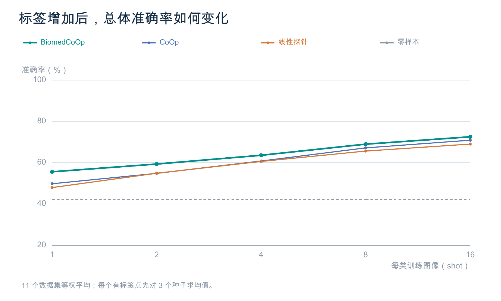
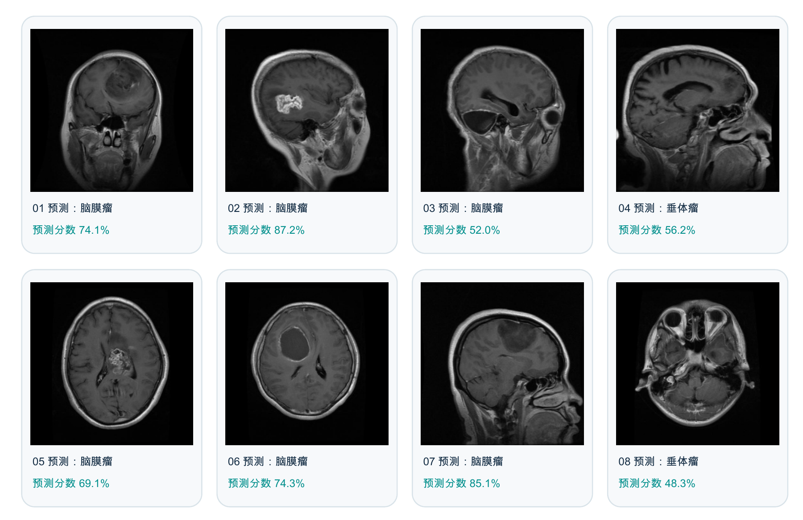

# BiomedCoOp / BiomedCLIP 少样本提示学习复现

[返回科研总览](../../README.md) · [返回仓库首页](../../../readme.md) · [阅读笔记](../../papernotes/biomedcoop.md) · [论文原文](../../papers/biomedcoop.pdf)

本目录整理用户所称“BiomedCLIP复现”对应的已完成材料：**以BiomedCLIP为冻结骨干的BiomedCoOp主实验复现**，不是BiomedCLIP从头预训练。图文报告与结果来自2026年10月16日完成的固定主实验，图文整理版日期为2026年10月18日；本次仅归档，未新增训练。

## 阅读入口

- [图文复现报告](复现报告.md)：27幅方法、数据、结果与案例图，及8张真实公开MRI原图。
- [原始主实验报告](results/BiomedCoOp完整主实验复现报告.md)：完整shot结果表、原文对照、配置差异与资源统计。
- [逐配置指标](results/per-run-metrics.csv)、[三种子汇总](results/summary-metrics.csv)、[标签预算](results/label-budgets.csv)。
- [实际训练曲线](results/curves/)、[共享支持集](results/supports/)、[各配置完成记录](results/completed/)。
- [冻结计划](protocol/plan.json)、[固定数据与模型来源](protocol/download-manifest.json)、[作者与实验代码](code/)、[运行工具](tools/)。

## 完成范围与主要结果

| 项目 | 结果与口径 |
| --- | --- |
| 主方法 | 冻结BiomedCLIP，仅学习4个文本context token；复用作者公开类别描述 |
| 数据与预算 | 11个独立分类数据集，1/2/4/8/16-shot，种子1/2/3 |
| 已完成配置 | BiomedCoOp 165、CoOp 165、线性探针165、零样本11，共506项 |
| 训练设置 | 提示方法固定100轮、末轮模型、FP32；跨方法共享精确train/val支持集 |
| 16-shot准确率 | BiomedCoOp 72.55%、CoOp 70.91%、线性探针69.04%、零样本42.04% |
| 汇总方式 | 每个数据集先对3个种子平均，再对11个数据集等权平均；零样本每数据集仅评估一次 |
| 方法差异 | BiomedCoOp比CoOp高1.64个百分点；11个数据集中6个上升、5个下降，未作显著性检验 |



不同模态来自不同数据集，未组成同一患者的多模态联合输入。该实验不包含AAS临床迁移验证，也不能据基准准确率确认临床效用。

## 真实图像与错误分析



上图是BTMRI、BiomedCoOp、16-shot、seed1按作者测试顺序的前8个错误，公开标签均为胶质瘤，图中列出预测类别和分数。它们是错误分析选样，不代表随机病例分布；分类分数不是校准后的诊断概率。原始图像和SHA见[追溯表](results/displayed-example-image-provenance.csv)，相应完整测试预测在[case-run](results/case-run/)。

## 目录结构

```text
biomedcoop-biomedclip/
├── README.md
├── 复现报告.md
├── images/                 # 图文报告用图与8张MRI原图
├── results/                # 原始报告、指标、330份曲线、165份支持集
│   ├── completed/          # 506项完成记录
│   └── case-run/           # 图文案例对应的BTMRI单次运行及1717条测试预测
├── code/                   # 实际作者代码、依赖、配置及公开划分
├── tools/                  # 实验运行、冻结和CUDA核验工具
├── protocol/               # 冻结计划、数据和基础权重来源
├── evidence/               # 完成核验、独立指标核验与环境记录
└── 文件清单.json            # 本次归档文件大小、SHA及范围说明
```

## 环境与运行材料说明

作者环境依赖见[requirements.txt](code/requirements.txt)，实际运行环境见[evidence/environment-state.json](evidence/environment-state.json)和冻结计划。代码的许可证保留于[LICENSE](code/LICENSE)。原实验使用Tesla T4、FP32、train batch4、test batch16、workers2；CoOp的batch等设置与公开配置的差异在原始报告中披露。

重新训练需要准备11个数据集、BiomedCLIP基础权重及分词器，恢复固定划分与支持集，并将冻结工具和配置中的原服务器路径迁移到运行环境。原工具会校验冻结源码SHA，不能只修改路径后继续声称与原计划SHA相同；如改动环境或路径，应另存新计划、重新核验并记录差异。本次未执行安装、下载或训练。

本目录保留报告相关材料、全部配置的完成元数据、完整330份训练曲线及165份公共支持集；逐例预测仅附案例对应的BTMRI单次完整测试。全量506项逐例预测及原始attempt日志仍保留于原主实验交付目录，未在本仓库重复同步。完整原始数据与模型权重亦不在本目录中；报告和冻结代码不等于可直接离线运行的完整模型备份。
