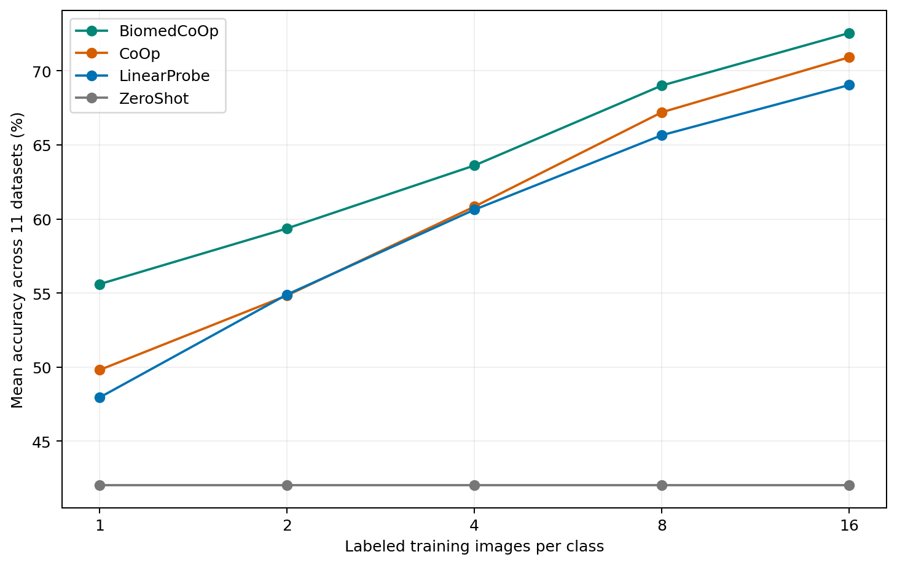
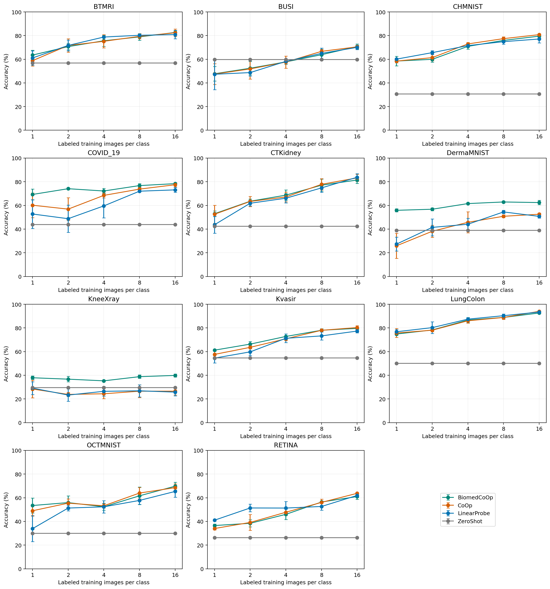
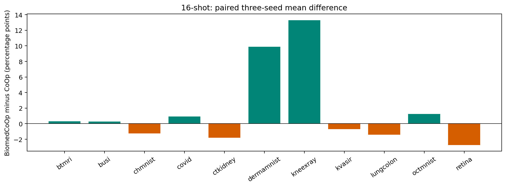
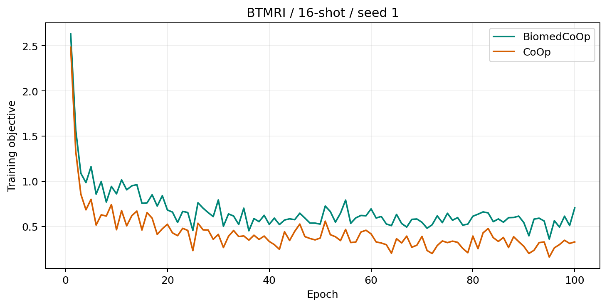
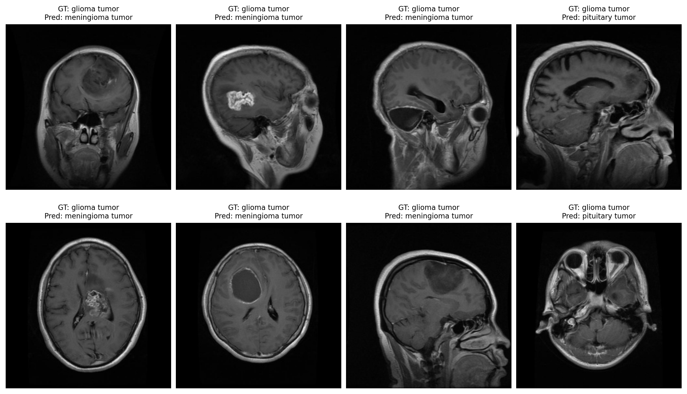

# BiomedCoOp完整主实验复现报告

## 1. 完成范围与主要结论

已核实506个配置：330次提示训练、165次线性探针拟合、11次零样本评估。主方法覆盖11个数据集、1/2/4/8/16-shot和种子1/2/3；两种有标签对照复用精确训练/验证支持集。本报告只覆盖已授权主实验。

16-shot下，BiomedCoOp在11个数据集上的平均准确率为 **72.55%**，CoOp为 **70.91%**，线性探针为 **69.04%**。BiomedCoOp相对CoOp平均差为 **+1.64个百分点**。该数值属于公开图像分类基准复现。

16-shot的11个数据集中，BiomedCoOp相对CoOp有 **6个上升、5个下降**。上升幅度最大的是KneeXray与DermaMNIST，RETINA、CTKidney、LungColon等数据集下降。三个种子仅描述本次采样下的波动，报告没有进行显著性检验或构造患者级置信区间。

## 2. 论文与方法

原论文：[BiomedCoOp，CVPR 2025](https://openaccess.thecvf.com/content/CVPR2025/html/Koleilat_BiomedCoOp_Learning_to_Prompt_for_Biomedical_Vision-Language_Models_CVPR_2025_paper.html)。固定代码：[HealthX-Lab/BiomedCoOp](https://github.com/HealthX-Lab/BiomedCoOp/tree/23710b0b867e8cb4a5ea95b0ccbaa5e35203db0d)。

图像由ViT-B/16编码，类别描述由BiomedBERT编码，归一化向量的相似度给出分类分数。可学习部分为4个上下文向量；图像与文本骨干冻结。作者已发布每个所用类别的50条描述，复现直接使用该提示库，无GPT服务调用。

训练目标包含有标签交叉熵、文本语义一致性MSE、选择提示的知识蒸馏KL。SCCM约束学习提示接近固定描述的平均语义；KDSP依据统计离群规则筛选描述，构建教师分类分布。各数据集的损失权重与阈值取公开配置。

这里的文本是类别描述；本任务的多个影像模态分布在不同数据集。它们没有组成同一患者的CT、病史与报告联合输入。

## 3. 数据、划分和标注预算

数据及模型均来自公开匿名下载地址，固定revision、SHA与实际校验记录随证据保存：[数据发布页](https://huggingface.co/datasets/TahaKoleilat/BiomedCoOp)、[BiomedCLIP权重](https://huggingface.co/microsoft/BiomedCLIP-PubMedBERT_256-vit_base_patch16_224)。使用作者固定train/val/test清单。

| 数据集 | 类别数 | 训练图像/类 | 验证图像/类 | 测试图像 |
|---|---:|---|---|---:|
| BTMRI | 4 | 1/2/4/8/16 | min(K,4) | 1717 |
| BUSI | 3 | 1/2/4/8/16 | min(K,4) | 236 |
| CHMNIST | 8 | 1/2/4/8/16 | min(K,4) | 1504 |
| COVID_19 | 4 | 1/2/4/8/16 | min(K,4) | 6351 |
| CTKidney | 4 | 1/2/4/8/16 | min(K,4) | 3738 |
| DermaMNIST | 7 | 1/2/4/8/16 | min(K,4) | 2005 |
| KneeXray | 5 | 1/2/4/8/16 | min(K,4) | 1656 |
| Kvasir | 8 | 1/2/4/8/16 | min(K,4) | 1200 |
| LungColon | 5 | 1/2/4/8/16 | min(K,4) | 7500 |
| OCTMNIST | 4 | 1/2/4/8/16 | min(K,4) | 1000 |
| RETINA | 4 | 1/2/4/8/16 | min(K,4) | 1268 |

完整支持集逐配置保存并跨方法核对；预算详见[label-budgets.csv](label-budgets.csv)。三种子均值不等于三倍独立患者数量。零样本仅评估一次，并在不同shot曲线上展示同一固定结果。

### 实际发布的完整数据池

下表为实际下载归档中作者固定划分的完整图像池；训练时仅使用上表的少样本支持集。图像数不等于患者数。

| 数据集 | 类别 | 完整训练池 | 完整验证池 | 固定测试集 |
|---|---:|---:|---:|---:|
| BTMRI | 4 | 2854 | 1141 | 1717 |
| BUSI | 3 | 389 | 155 | 236 |
| CHMNIST | 8 | 2496 | 1000 | 1504 |
| COVID_19 | 4 | 10582 | 4232 | 6351 |
| CTKidney | 4 | 6221 | 2487 | 3738 |
| DermaMNIST | 7 | 7006 | 1003 | 2005 |
| KneeXray | 5 | 5778 | 826 | 1656 |
| Kvasir | 8 | 2000 | 800 | 1200 |
| LungColon | 5 | 12500 | 5000 | 7500 |
| OCTMNIST | 4 | 97476 | 10832 | 1000 |
| RETINA | 4 | 2108 | 841 | 1268 |

DermaMNIST实际训练池为 **7006**，OCTMNIST为 **97476**。[作者数据说明](https://github.com/HealthX-Lab/BiomedCoOp/blob/23710b0b867e8cb4a5ea95b0ccbaa5e35203db0d/assets/DATASETS.md)对应数字为7007、97477；本次按发布文件及其固定清单的实际计数报告，保留差异，没有补造图像或改变划分。

原始归档和划分SHA见[actual-released-splits.csv](actual-released-splits.csv)，本机准备核验证明见[actual-data-ready-proof.json](actual-data-ready-proof.json)。

## 4. 环境、实现和公平对照

- Tesla T4，FP32，训练batch4、测试batch16、worker2。
- BiomedCoOp与CoOp均100轮、SGD及公开余弦调度，固定使用末轮。
- BiomedCoOp LR0.0025，各数据集SCCM/KDSP/tau取作者配置；CoOp保留公开配置LR0.002。
- 线性探针采用公开lbfgs逻辑回归、max_iter1000、7个粗网格C和8轮验证搜索；测试预测只在最终选定C后生成。
- 原线性入口的采样函数缺少return，本复现使用相同精确支持集与min(K,4)验证集。
- 确定性视觉测试特征按权重、转换、图像路径/stat绑定缓存；最终图文相似度在验证图像上与原始推理做代数一致性检查。
- 每轮保存可学习权重/优化器/调度器/随机状态，另保存作者完整末轮checkpoint；失败尝试保留。

环境：`{"torch": "2.1.0+cu121", "torchvision": "0.16.0+cu121", "numpy": "1.26.4", "Pillow": "10.4.0", "timm": "0.9.12", "transformers": "4.35.2", "scikit-learn": "1.3.2", "matplotlib": "3.8.4", "tensorboard": "2.15.2", "open_clip_torch": "2.23.0"}`。

### 已披露的协议或环境差异

- PyTorch使用2.1.0+cu121、torchvision0.16.0，满足公开torch>=2.0.1要求；与示例环境torch2.0.1/cu118不同。
- 测试batch从公开100改为16，数据加载worker从8改为2。
- 公开CoOp配置batch32改为4，使同支持集对照适应当前设备；公开CoOp LR0.002保留，BiomedCoOp为0.0025。
- 模型构造后重设提示训练随机状态，避免首次支持集缓存创建影响后续训练随机流。
- 线性探针修复公开入口采样函数缺少return的问题，统一使用精确共享训练集与每类min(K,4)验证集；公开入口存在不同的验证重采样逻辑。
- 缓存确定性冻结视觉测试特征，绑定基础权重、预处理、路径顺序、标签、字节数、精确整数mtime_ns、精度与batch；在验证图像上检查最终提示logits与原始推理的代数一致性。
- 未固定版本的tb-nightly替换为稳定tensorboard2.15.2；没有导入的lint/wilds依赖未安装。
- 每轮额外写入紧凑恢复断点，含可学习权重、优化器、调度器及Python/NumPy/Torch/CUDA随机状态；另保留未修改作者保存逻辑输出的完整末轮checkpoint。

## 5. 定量结果

原文目标与本次总体值（%）如下。原文数值是参考；当前协议差异已披露。

| 每类训练图像 | 原文BiomedCoOp | 本次BiomedCoOp | 本次CoOp | 本次LP | 本次零样本 |
|---:|---:|---:|---:|---:|---:|
| 1 | 57.03 | 55.61 | 49.81 | 47.95 | 42.04 |
| 2 | 59.13 | 59.36 | 54.84 | 54.90 | 42.04 |
| 4 | 63.95 | 63.61 | 60.83 | 60.63 | 42.04 |
| 8 | 68.32 | 69.01 | 67.20 | 65.66 | 42.04 |
| 16 | 72.42 | 72.55 | 70.91 | 69.04 | 42.04 |

### 各数据集16-shot，三种子均值 ± 总体标准差

| 数据集 | BiomedCoOp | CoOp | 线性探针 | B−CoOp（百分点） |
|---|---:|---:|---:|---:|
| BTMRI | 82.64 ± 1.46 | 82.35 ± 3.15 | 80.82 ± 3.55 | +0.29 |
| BUSI | 70.76 ± 2.10 | 70.48 ± 1.40 | 70.06 ± 1.97 | +0.28 |
| CHMNIST | 79.52 ± 1.41 | 80.78 ± 0.77 | 77.11 ± 3.21 | -1.26 |
| COVID_19 | 78.39 ± 0.86 | 77.47 ± 1.79 | 73.13 ± 2.08 | +0.92 |
| CTKidney | 81.49 ± 2.88 | 83.28 ± 3.09 | 83.80 ± 3.06 | -1.79 |
| DermaMNIST | 62.41 ± 1.82 | 52.54 ± 1.00 | 50.74 ± 1.39 | +9.88 |
| KneeXray | 39.86 ± 1.31 | 26.55 ± 3.24 | 25.74 ± 3.17 | +13.31 |
| Kvasir | 79.61 ± 0.39 | 80.31 ± 1.60 | 77.33 ± 1.46 | -0.69 |
| LungColon | 92.61 ± 0.68 | 94.02 ± 0.16 | 93.42 ± 0.34 | -1.41 |
| OCTMNIST | 69.77 ± 3.27 | 68.53 ± 3.15 | 65.33 ± 4.95 | +1.23 |
| RETINA | 61.01 ± 2.29 | 63.75 ± 0.37 | 61.96 ± 1.70 | -2.73 |

各种子及两种标准差见[summary-metrics.csv](summary-metrics.csv)。准确率之外，平衡准确率、macro-F1、AUROC及资源见[per-run-metrics.csv](per-run-metrics.csv)。AUROC使用二分类阳性概率或多分类macro OVR；它衡量分数排序，与某个固定阈值的准确率含义不同。

### 完整1/2/4/8/16-shot结果

每格为三个种子的均值 ± 总体标准差（ddof=0），单位为准确率百分数。零样本为每数据集一次固定评估。所有单种子值和样本标准差（ddof=1）保留在CSV。

| 数据集 | shot | BiomedCoOp | CoOp | 线性探针 | 零样本 |
|---|---:|---:|---:|---:|---:|
| BTMRI | 1 | 63.50 ± 4.16 | 58.78 ± 4.60 | 61.08 ± 6.07 | 56.79 |
| BTMRI | 2 | 70.67 ± 2.65 | 71.64 ± 5.69 | 71.68 ± 4.57 | 56.79 |
| BTMRI | 4 | 75.62 ± 4.71 | 75.15 ± 5.58 | 78.76 ± 0.91 | 56.79 |
| BTMRI | 8 | 78.90 ± 2.84 | 79.36 ± 2.08 | 80.26 ± 0.88 | 56.79 |
| BTMRI | 16 | 82.64 ± 1.46 | 82.35 ± 3.15 | 80.82 ± 3.55 | 56.79 |
| BUSI | 1 | 47.74 ± 6.09 | 47.46 ± 8.77 | 47.32 ± 12.99 | 59.75 |
| BUSI | 2 | 52.40 ± 5.71 | 51.84 ± 8.53 | 48.73 ± 2.83 | 59.75 |
| BUSI | 4 | 57.77 ± 2.03 | 57.63 ± 5.12 | 58.19 ± 1.31 | 59.75 |
| BUSI | 8 | 63.84 ± 4.59 | 66.67 ± 1.71 | 64.97 ± 4.45 | 59.75 |
| BUSI | 16 | 70.76 ± 2.10 | 70.48 ± 1.40 | 70.06 ± 1.97 | 59.75 |
| CHMNIST | 1 | 58.47 ± 4.01 | 58.42 ± 1.36 | 60.11 ± 0.25 | 30.65 |
| CHMNIST | 2 | 59.93 ± 2.39 | 61.37 ± 2.76 | 65.58 ± 1.64 | 30.65 |
| CHMNIST | 4 | 70.88 ± 2.39 | 72.94 ± 1.35 | 71.52 ± 0.96 | 30.65 |
| CHMNIST | 8 | 75.91 ± 1.47 | 77.42 ± 1.55 | 74.87 ± 2.21 | 30.65 |
| CHMNIST | 16 | 79.52 ± 1.41 | 80.78 ± 0.77 | 77.11 ± 3.21 | 30.65 |
| COVID_19 | 1 | 69.26 ± 4.55 | 60.18 ± 10.44 | 52.74 ± 12.20 | 43.82 |
| COVID_19 | 2 | 74.12 ± 0.65 | 56.86 ± 9.61 | 48.77 ± 11.46 | 43.82 |
| COVID_19 | 4 | 72.19 ± 2.11 | 68.47 ± 2.05 | 59.58 ± 10.06 | 43.82 |
| COVID_19 | 8 | 76.75 ± 1.59 | 73.77 ± 1.50 | 72.03 ± 0.45 | 43.82 |
| COVID_19 | 16 | 78.39 ± 0.86 | 77.47 ± 1.79 | 73.13 ± 2.08 | 43.82 |
| CTKidney | 1 | 52.97 ± 2.32 | 52.54 ± 7.65 | 43.66 ± 7.07 | 42.43 |
| CTKidney | 2 | 63.55 ± 1.79 | 63.34 ± 4.36 | 61.83 ± 2.25 | 42.43 |
| CTKidney | 4 | 68.67 ± 4.39 | 67.15 ± 4.20 | 66.07 ± 3.86 | 42.43 |
| CTKidney | 8 | 77.07 ± 5.11 | 77.80 ± 4.79 | 74.80 ± 3.72 | 42.43 |
| CTKidney | 16 | 81.49 ± 2.88 | 83.28 ± 3.09 | 83.80 ± 3.06 | 42.43 |
| DermaMNIST | 1 | 55.86 ± 1.31 | 25.89 ± 10.56 | 27.32 ± 5.83 | 38.80 |
| DermaMNIST | 2 | 56.77 ± 1.16 | 38.14 ± 5.08 | 41.43 ± 7.10 | 38.80 |
| DermaMNIST | 4 | 61.55 ± 0.47 | 45.72 ± 8.87 | 44.09 ± 5.10 | 38.80 |
| DermaMNIST | 8 | 62.91 ± 0.71 | 50.82 ± 1.18 | 54.50 ± 1.42 | 38.80 |
| DermaMNIST | 16 | 62.41 ± 1.82 | 52.54 ± 1.00 | 50.74 ± 1.39 | 38.80 |
| KneeXray | 1 | 37.88 ± 1.47 | 28.34 ± 7.38 | 29.15 ± 5.40 | 29.47 |
| KneeXray | 2 | 36.69 ± 2.29 | 23.81 ± 1.76 | 23.25 ± 5.29 | 29.47 |
| KneeXray | 4 | 35.29 ± 0.60 | 24.36 ± 4.21 | 26.43 ± 4.06 | 29.47 |
| KneeXray | 8 | 38.81 ± 1.45 | 26.53 ± 5.47 | 26.85 ± 5.15 | 29.47 |
| KneeXray | 16 | 39.86 ± 1.31 | 26.55 ± 3.24 | 25.74 ± 3.17 | 29.47 |
| Kvasir | 1 | 61.19 ± 0.63 | 57.61 ± 3.54 | 54.47 ± 3.98 | 54.58 |
| Kvasir | 2 | 66.31 ± 2.29 | 63.58 ± 1.24 | 59.75 ± 3.15 | 54.58 |
| Kvasir | 4 | 72.78 ± 0.21 | 70.81 ± 1.49 | 71.22 ± 3.68 | 54.58 |
| Kvasir | 8 | 78.03 ± 1.26 | 77.97 ± 0.52 | 73.25 ± 3.40 | 54.58 |
| Kvasir | 16 | 79.61 ± 0.39 | 80.31 ± 1.60 | 77.33 ± 1.46 | 54.58 |
| LungColon | 1 | 74.84 ± 1.05 | 75.72 ± 3.72 | 76.76 ± 1.80 | 50.01 |
| LungColon | 2 | 78.24 ± 0.63 | 78.06 ± 1.25 | 80.24 ± 5.02 | 50.01 |
| LungColon | 4 | 86.64 ± 2.11 | 86.03 ± 1.95 | 87.41 ± 1.28 | 50.01 |
| LungColon | 8 | 88.84 ± 1.12 | 88.83 ± 1.58 | 90.33 ± 1.51 | 50.01 |
| LungColon | 16 | 92.61 ± 0.68 | 94.02 ± 0.16 | 93.42 ± 0.34 | 50.01 |
| OCTMNIST | 1 | 53.43 ± 6.22 | 49.00 ± 4.44 | 33.87 ± 10.97 | 29.90 |
| OCTMNIST | 2 | 55.90 ± 5.62 | 55.43 ± 3.50 | 51.30 ± 2.36 | 29.90 |
| OCTMNIST | 4 | 52.37 ± 2.92 | 53.20 ± 1.84 | 52.33 ± 5.25 | 29.90 |
| OCTMNIST | 8 | 61.63 ± 7.39 | 63.97 ± 4.81 | 57.73 ± 3.36 | 29.90 |
| OCTMNIST | 16 | 69.77 ± 3.27 | 68.53 ± 3.15 | 65.33 ± 4.95 | 29.90 |
| RETINA | 1 | 36.51 ± 1.33 | 33.99 ± 1.18 | 41.04 ± 0.72 | 26.26 |
| RETINA | 2 | 38.41 ± 3.00 | 39.14 ± 6.71 | 51.37 ± 3.22 | 26.26 |
| RETINA | 4 | 45.98 ± 4.36 | 47.74 ± 2.78 | 51.29 ± 5.58 | 26.26 |
| RETINA | 8 | 56.39 ± 0.89 | 56.07 ± 2.74 | 52.63 ± 3.16 | 26.26 |
| RETINA | 16 | 61.01 ± 2.29 | 63.75 ± 0.37 | 61.96 ± 1.70 | 26.26 |

总体曲线先对同一数据集的三个种子取均值，再对11个数据集等权平均。它不是将所有测试图像混在一起的准确率；测试集规模较大的LungColon、COVID不会因图像更多而获得更高权重。

## 6. 训练曲线与真实图像示例

两种方法的训练目标项不同，曲线用于检查各自运行趋势。

示例优先选择固定BTMRI/16-shot/seed1中按官方测试顺序出现的错误，数量不足时补入后续样例。原路径和预测见[displayed-examples.csv](displayed-examples.csv)。标签以公共数据集提供的信息为准。

### 八个真实错误示例的追溯

下列链接为从公开数据中直接复制的原始图像字节，未进行生成式替换。原路径、SHA及模型分数见[图像追溯CSV](displayed-example-image-provenance.csv)。

| 示例 | 公开标签 | 模型预测 | 预测类别概率 |
|---|---|---|---:|
| [图1](example-images/01-image05.jpg) | glioma tumor | meningioma tumor | 0.7408 |
| [图2](example-images/02-image1013.jpg) | glioma tumor | meningioma tumor | 0.8724 |
| [图3](example-images/03-image1113.jpg) | glioma tumor | meningioma tumor | 0.5204 |
| [图4](example-images/04-image119.jpg) | glioma tumor | pituitary tumor | 0.5620 |
| [图5](example-images/05-image1230.jpg) | glioma tumor | meningioma tumor | 0.6915 |
| [图6](example-images/06-image1267.jpg) | glioma tumor | meningioma tumor | 0.7432 |
| [图7](example-images/07-image1303.jpg) | glioma tumor | meningioma tumor | 0.8510 |
| [图8](example-images/08-image145.jpg) | glioma tumor | pituitary tumor | 0.4834 |

## 7. 耗时、显存与恢复

所有配置实际invocation耗时累计 **31.33小时**；各配置自身Torch allocated峰值最大 **2.46GiB**，reserved峰值最大 **2.59GiB**。allocated/reserved是本进程统计。整卡显存可包含其他任务。

数据下载、准备、首次CUDA核验、特征缓存和失败尝试与正式训练结果分别记录。GPU启用曾重建容器导致旧overlay文件丢失，随后改用已核实宿主挂载目录并重新下载校验。环境中的NumPy/PyTorch兼容问题通过隔离环境解决。具体错误、恢复及时间线随证据保存。

## 8. 局限及AAS研究意义

- 样本单位是公开图像，患者级独立性、重复或预训练数据重叠不能凭官方文件分区完全确认。
- 三个种子的标准差描述少标签采样波动，不能当临床患者级置信区间。
- 部分数据包含派生、增强或便捷抽样图像；类别比例与真实患病率不等。
- 原公开配置与论文文字存在差异；同支持集对照、低显存调整和修复均已披露。
- 本次AAS迁移意义主要是预训练图文空间和少标签提示学习的复现能力。后续单院平扫CT加诊断时可获得的临床文本，仍需CTA参考诊断、患者级/时间划分、避免检查后文本泄漏及独立评估。
- 复现数值与方法优劣按实际CSV报告，局部下降同样保留。

## 9. 可核查附件

- [逐配置指标](per-run-metrics.csv)
- [三种子结果](summary-metrics.csv)
- [标注预算](label-budgets.csv)
- [完成证据与SHA](completion-evidence.json)
- 图目录含同名PNG/PDF。服务器保存模型checkpoint与逐例预测；交付报告包不自动包含全部数据或大体积权重。

## 10. 下载到完成的执行记录

| 阶段 | 北京时间与实际处理 | 最终状态 |
|---|---|---|
| 公开资源与代码固定 | 使用作者commit和公开匿名模型/数据revision；Mac匿名HTTP读取并经已有SSH中转 | 所有资源免申请，来源清单及SHA保留 |
| 存储恢复 | GPU启用曾重建容器并丢失旧overlay；将正式项目落到宿主ext4挂载目录/root/BiomedCLIP/BiomedCoOp，/root/BiomedCoOp为入口 | 旧15项仅历史，不加到506 |
| 环境准备 | 隔离.venv复用共享系统包，覆盖NumPy为1.26.4；65份公开PyPI wheel共141,892,828字节并校验官方SHA | 没有改动共享环境 |
| CUDA核验 | 两次实际反向传播分别覆盖BTMRI和CHMNIST，梯度有限、骨干冻结；它们不计正式预算 | 通过后使用冻结计划 |
| 正式训练启动 | 2026-10-14 22:18:57；监督器随后接续，跳过已经完成的第一项 | 11数据集统一冻结协议 |
| 传输修复 | v1退出130后，v2从38,273,024字节前缀接续，4个有界1MiB范围请求，核对206/Content-Range并遵守429等待 | 原错误与修复证据保留 |
| 最后归档 | RETINA于2026-10-15 02:13:28完整服务器SHA通过 | 没有根据旧下载计数重新下载 |
| 全部下载/准备 | 2026-10-15 02:19:46确认21/21文件、11,658,452,387字节，11/11划分和全部路径、模型缓存完成；生产器exit0，下载/准备锁释放 | 之后训练不依赖Mac转发或服务器公网 |
| 数据集独立审计 | 每数据集46份completed、精确支持、逐例概率/准确率、测试顺序/缓存、30份100轮日志与训练访问，回传后逐文件SHA/字节复核 | 11数据集唯一集合506，不累加历史子集 |
| 正式队列结束 | 2026-10-16 06:49:27；状态experiments complete; report pending，child None，监督器正常退出，两训练锁释放 | 506/506，失败列表空，OOM0 |
| 报告生成 | 506完成后才生成本报告、5类PNG/PDF、完整CSV，再进行打包和逐图检查 | 训练完成与最终交付分别核验 |

下载时依赖Mac联网及SSH中转，没有声称服务器独立公网下载。下载和准备正常退出后，正式训练由服务器监督器独立继续。实时页面核查、证据回传和最终本地交付仍需要Mac及SSH。

本机维护阶段曾出现提前读取未完成SSH输出的JSONDecodeError，以及读取旧checkpoint字段的KeyError；等待原命令完成、按已存在字段/文件修复后通过，原证据保留。这些是本机核查异常，未修改原始图像、基础权重、缓存或冻结训练协议。

### 耗时口径

从正式首次训练到队列结束的墙钟时间约32小时30分钟；逐配置invocation秒数累计为前文31.33小时，两者起止口径不同。invocation时间包含对应运行的准备/推理等过程；它不是独占GPU时长、GPU利用率或费用。Tesla T4整卡含其他任务，本实验没有干预其进程或显存。

## 11. 标注、训练访问与选择规则

三个有标签方法各有165项。每个方法将165份支持集的训练图像使用预算相加为5208次、验证图像预算为2520次；不同配置会复用图像，这些相加值不能当独立已标注图像或独立患者数。零样本的训练/验证标签预算均为0。

每个配置的训练集为每类K图，验证集为每类min(K,4)图。三方法共享同一份精确train/val清单及同一测试顺序；线性探针的C仅由验证结果决定。提示方法运行固定100轮，并统一取末轮，没有按照测试分数挑选epoch。所有种子和无提升结果保留。

支持集预算与每轮实际访问数是两个口径。保留作者batch4及末批丢弃行为，例如LungColon为5类：1-shot支持5图但每轮访问4图，2-shot支持10图但每轮访问8图；4/8/16-shot每轮访问20/40/80图。所有训练访问均属于冻结支持集；完整330份曲线CSV和原始attempt日志用于核对实际轮次、batch和图像访问，不能将预算直接乘100后当实际访问数。

提示训练失败恢复使用每轮紧凑断点中的优化器、调度器和随机状态；同一配置的attempt按实际轮次合并。当前主监督器失败列表为空，原始尝试和维护历史仍随包保存。

### 指标与不确定性

- Accuracy为固定测试集的正确比例；balanced accuracy为各类召回率平均；macro-F1为各类F1等权平均；本次11个任务均为多分类，AUROC使用macro OVR。
- CSV中的accuracy/balanced accuracy单位为百分数，macro_f1/auroc单位为0到1；图中误差棒为三个种子的总体标准差。
- 三个随机种子不是独立患者抽样，标准差不构成临床诊断性能的置信区间。
- 原文总体目标与本次差异同时报告；协议、软件和设备差异存在，数值接近不能证明每一步均与论文原实验相同。

## 12. 完整证据与复查入口

最终包根目录的README说明布局；本报告在report/。完整逐例预测、支持集、invocation、原始attempt和线性探针验证搜索位于`evidence/project/runs/main-v1-20261014/`；公共支持集位于`evidence/project/reports/main-v1-20261014/supports/`。`curves/`含330份实际100轮曲线CSV。

- `delivery-proof.json`：506项、330曲线、跨方法支持/测试顺序、指标与源码基础权重绑定的服务器打包核验。
- `delivery-index.json`：服务器包逐文件SHA/字节；本地最终维护附件和视觉核验另有本地索引，二者保留不同覆盖范围。
- `checkpoint-locations.json`：660个末轮/恢复文件的位置、字节数和精确mtime_ns；未重新计算完整checkpoint内容SHA，文件内容不在交付包中。
- `evidence/local/`：本实验顶层维护、下载、恢复和独立核验历史，不包含wheelhouse、原始数据或基础大权重。
- [实际发布划分](actual-released-splits.csv)、[全部完成汇总](all-main-completed-local-proof.json)、[原始生成完成清单](completion-evidence.json)。

最终交付包包含用于报告展示的8个真实BTMRI图像示例及其组合图；不包含完整原始数据集或完整模型权重，不构成完整模型备份。逐例预测的图像路径保留用于追溯。

### 固定标识

- 作者commit：`23710b0b867e8cb4a5ea95b0ccbaa5e35203db0d`。
- 冻结plan SHA256：`a69b43169203ed9e7bf94bed344b67d82a635e501bd424165c6c2ee5fdac981f`。
- 基础权重SHA256：`52cc993c5c5ff962bd0c60931874bc001e7e9b41666a385530f4a036294576be`。
- 数据/模型/分词器的固定revision与匿名URL见交付包`evidence/project/manifests/download-manifest.json`；作者源码和运行工具随包保留。

病例示例由固定BTMRI/16-shot/seed1中按官方测试顺序出现的前8个错误组成，属于错误分析选样，不是随机样本或患者代表性证明。其真实标签来自公共数据集，预测来自已完成的模型输出，图像没有使用生成式工具制作或替换。
