# BiomedCoOp 复现报告（基于BiomedCLIP）

[复现入口与材料说明](README.md) · [论文阅读笔记](../../papernotes/biomedcoop.md) · [论文原文](../../papers/biomedcoop.pdf)

本报告对应BiomedCoOp的少样本提示学习主实验，使用冻结的BiomedCLIP图像／文本编码器；没有从头复现BiomedCLIP预训练。本文沿用已完成的图文报告，配套数值表、曲线、代码与冻结设置见本目录README。

## 一、复现概况与主要发现

BiomedCoOp 是 CVPR 2025 提出的医学视觉语言模型提示学习方法，关注少量标注条件下的医学图像分类。本次复现以作者公开代码、类别描述库和固定数据划分为基础，完成了 11 个数据集上的完整主实验，并与 CoOp、线性探针和零样本方法进行比较。报告围绕方法原理、实验设计、结果曲线和真实影像样例展开，将主要结论与相应图形放在一起，便于理解实验过程及其结果。

在每类使用 16 张训练图像时，BiomedCoOp 的总体准确率为 **72.55%**，CoOp 为 70.91%，线性探针为 69.04%。这里的总体结果先对每个数据集的三个种子取平均，再对 11 个数据集等权汇总，因此不会由测试图像较多的数据集主导。按照这一口径，BiomedCoOp 相对 CoOp 的平均优势为 **1.64 个百分点**，体现了本次设置下医学提示学习的总体收益。

总体收益同时伴随着明显的数据集差异：16-shot 下有 **6 个数据集上升、5 个下降**，其中 KneeXray 和 DermaMNIST 的相对提升较大。部分数据集上，两种提示方法非常接近，也有数据集由 CoOp 获得更高准确率。因此，本次结果支持的是跨数据集平均表现有所改善，后文仍需结合各数据集曲线、随机种子波动和错误样例理解这一结论。

## 二、方法原理：让医学描述参与提示学习

### 2.1 图像与类别文本如何完成匹配

基础图文模型分别将医学图像和类别文本编码为向量，再根据它们的相似度进行分类。提示学习在类别名之前加入可学习的上下文，让少量已标注图像能够影响类别文本的表示。本次复现冻结图像编码器和文本编码器，只训练 4 个上下文向量，使学习过程集中在提示部分。

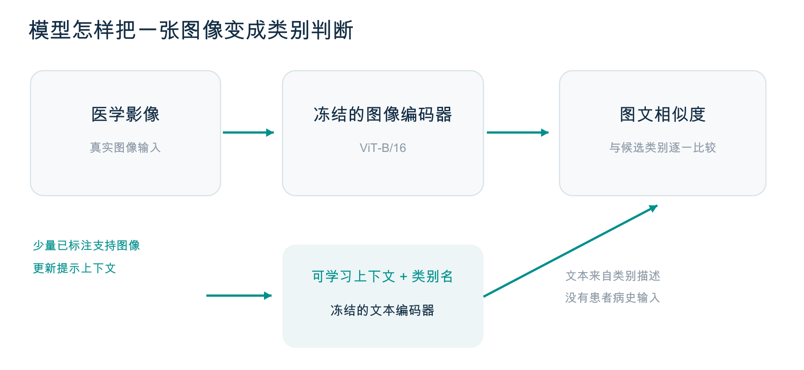

*图 1｜本次推理流程示意：编码器冻结，可学习部分为提示上下文。*

医学类别通常可以通过多种语言描述，不同描述会突出不同的类别特征。BiomedCoOp 利用这些描述提供额外的语义约束，使提示在适应少量标签时仍与已有医学文本知识保持联系。本次直接使用作者发布的每个所用类别 50 条描述，没有重新调用 GPT 或其他大语言模型生成提示；这些文本都是类别描述，不包含患者病史或个体报告。

### 2.2 三项训练目标如何共同作用

作者方法将图像标签监督、医学语义约束和提示教师知识结合起来，下面的方法图展示了它们之间的关系。图中的 LLM 对应作者原始提示库的构建环节，本次复现直接读取已经发布的提示库。医学描述通过文本编码和提示筛选提供训练约束，少量支持图像则通过分类目标参与提示学习。

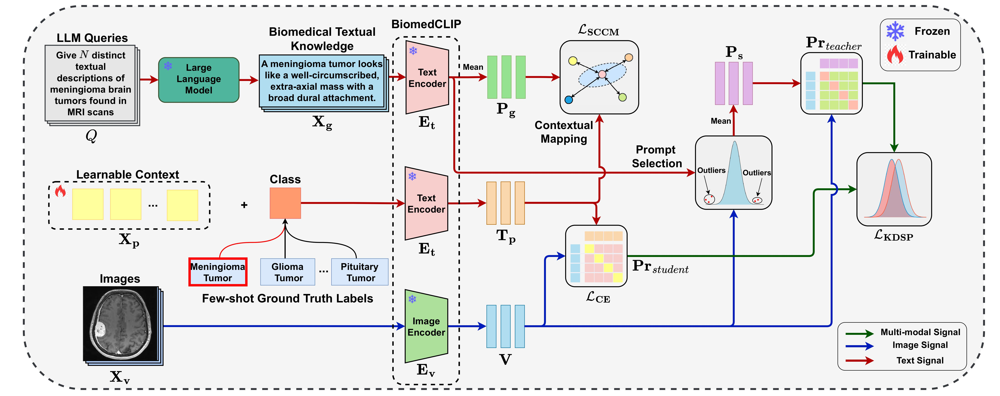

*图 2｜作者原始方法图，来源为[固定版本仓库](https://github.com/HealthX-Lab/BiomedCoOp/tree/23710b0b867e8cb4a5ea95b0ccbaa5e35203db0d)中的 assets/BiomedCoOp.jpg。*

训练目标中的交叉熵（CE）使用图像标签指导分类，语义一致性约束（SCCM）使学习提示接近类别描述的平均语义。提示知识蒸馏（KDSP）进一步筛选描述，并利用教师分类分布约束学习提示对应的输出。三项损失共同更新可学习上下文，其权重与筛选阈值沿用作者针对各数据集发布的配置。

*图 3｜语义一致性使用 MSE，提示蒸馏使用 KL，分类监督使用交叉熵。*

## 三、实验设计与数据覆盖

### 3.1 使用相同支持集比较四种方法

完整主实验覆盖每类 1、2、4、8、16 张训练图像，以及种子 1、2、3。对于相同的数据集、shot 和种子，BiomedCoOp、CoOp 与线性探针复用精确相同的训练和验证支持图像，从而减少采样差异对方法比较的影响。零样本方法在每个数据集上单独评估一次，其固定结果在不同 shot 的曲线中重复展示。

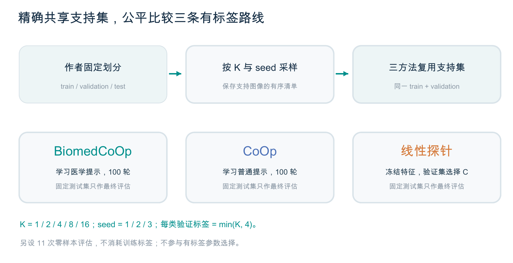

*图 4｜三种有标签方法共享训练与验证支持集，线性探针只用验证集选择 C。*

两种提示方法各完成 165 次训练，线性探针完成 165 次拟合，加上 11 次零样本评估，共形成 506 个配置。提示训练均为 100 轮，并固定使用末轮模型；训练 batch 为 4，测试 batch 为 16，计算精度为 FP32。每类训练标签预算为 K，验证标签预算为 min(K,4)，测试集只用于最终评估。

*图 5｜11 个数据集、5 个 shot 档位、3 个种子与 3 种有标签方法构成 495 个配置，另有 11 个零样本配置。*

### 3.2 多种影像模态下的独立基准

11 个数据集覆盖脑部 MRI、乳腺超声、组织病理、胸部 X 光、肾脏 CT、皮肤镜、膝关节 X 光、消化道内镜、视网膜 OCT 和眼底照片。各数据集采用作者固定的训练、验证与测试划分，分别检验模型在对应分类任务上的表现。这些模态来自不同数据集，并未组成同一患者的多模态联合输入，图像数量也不能直接换算为患者数量。

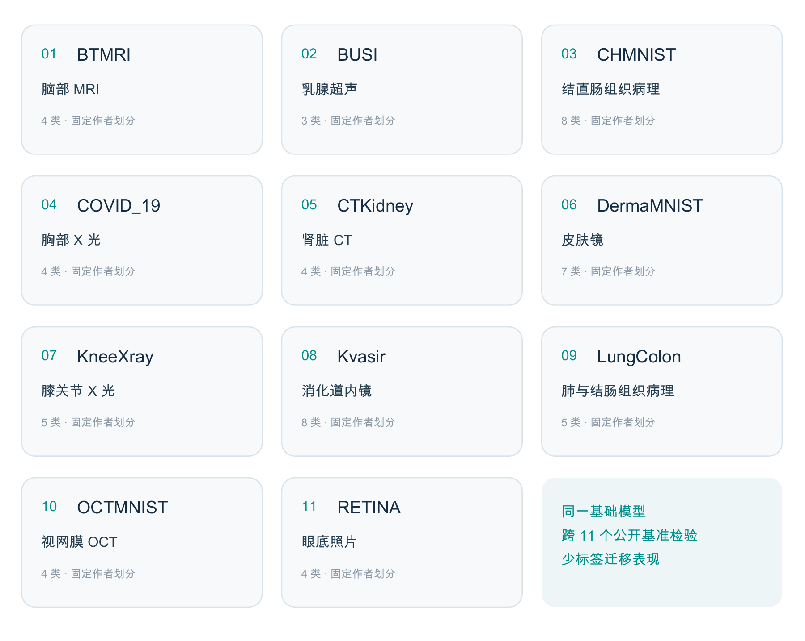

*图 6｜数据集覆盖范围与类别数，卡片为信息示意，未使用合成医学影像。*

数据准备以实际发布的文件和清单为准，其中 DermaMNIST 的训练池为 7,006 张，OCTMNIST 为 97,476 张，均比作者说明少 1 张。本次保留了这一差异，没有补造图像或更改划分。训练时仍然只从完整训练池中使用相应的少样本支持集，完整数据池大小并不等于实际标签预算。

## 四、总体结果与收益分布

### 4.1 标签数量增加后的总体变化

总体曲线显示，随着每类训练图像从 1 张增加到 16 张，三种有标签方法的平均准确率均有所提高。BiomedCoOp 在五个 shot 档位上的跨数据集均值都高于 CoOp 和线性探针，但方法间距并未保持固定。零样本曲线是一条水平线，因为它没有使用新增训练标签，也没有针对不同 shot 重新训练。

*图 7｜每个有标签点先对三个种子取均值，再对 11 个数据集等权平均。*

将 BiomedCoOp 与 CoOp 的总体均值相减，可以更清楚地看到收益随标签预算的变化。低 shot 下的平均优势较大，随着标签增加，CoOp 的总体准确率也逐步提高，两者之间的差距有所缩小。这说明少量标签条件下的结果值得单独关注，但当前曲线本身不能确定收益来自哪一项训练约束。

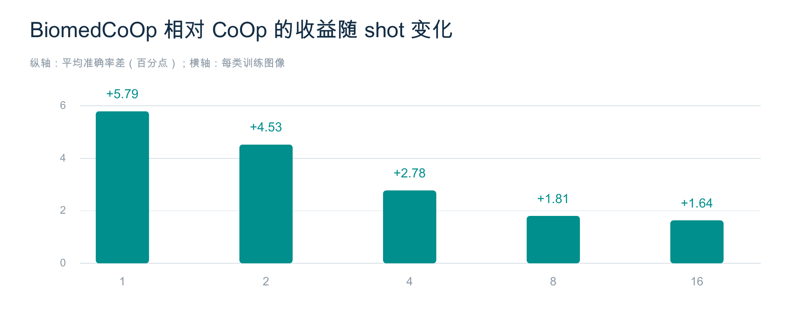

*图 8｜纵轴为准确率差，单位为百分点；本次没有进行显著性检验。*

### 4.2 平均提升在各数据集上并不均匀

16-shot 的配对均值差显示，KneeXray 与 DermaMNIST 对总体正收益的贡献较为突出。其余多数数据集的差距较小，正负方向同时存在。结合这些分项结果，可以避免仅凭总体平均值判断模型在每一种影像任务上都更有效。

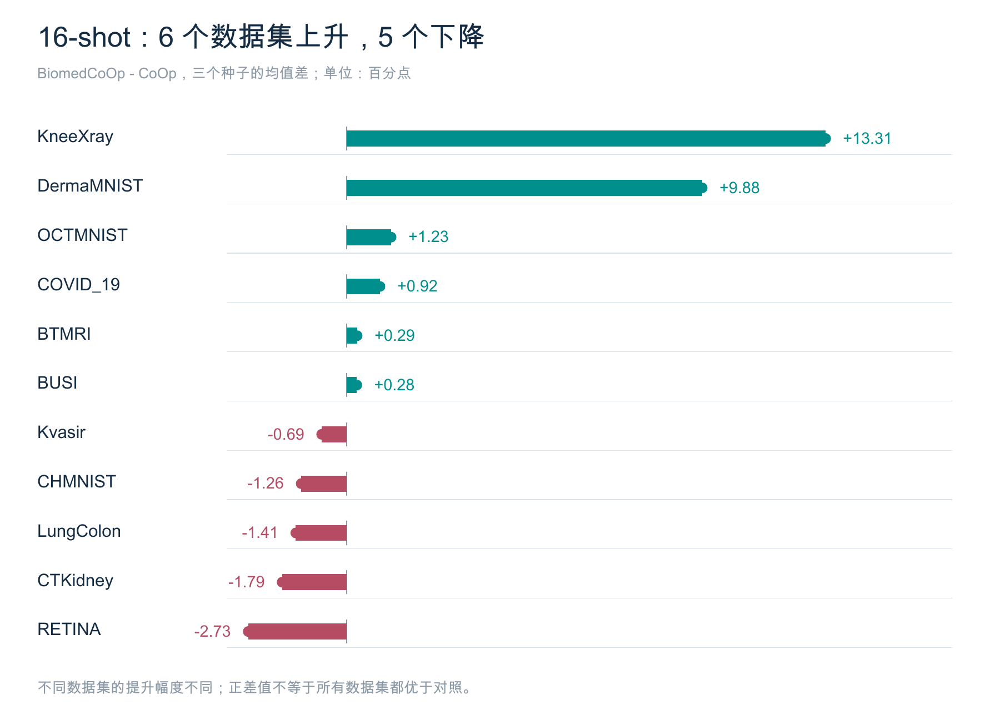

*图 9｜BiomedCoOp 减去 CoOp 的三个种子均值，上升 6 个数据集、下降 5 个。*

相对提升与绝对性能需要同时考虑，例如 KneeXray 的收益虽然较大，BiomedCoOp 的准确率仍只有 39.86%。另一方面，RETINA、CTKidney、LungColon、CHMNIST 和 Kvasir 在这一设置下低于 CoOp。报告保留了这些下降结果，也没有把基准分类上的收益直接解释为临床可用性。

## 五、各数据集的结果解读

以下曲线使用相同的 0-100% 纵轴，横轴均为每类训练图像数，所有有标签点均展示三个种子的均值。绿色代表 BiomedCoOp，蓝色代表 CoOp，橙色代表线性探针，灰色虚线代表零样本。统一坐标范围有助于比较绝对准确率，而较接近的方法仍需结合前面的差值图阅读。

### 5.1 脑部 MRI、乳腺超声与结直肠组织病理

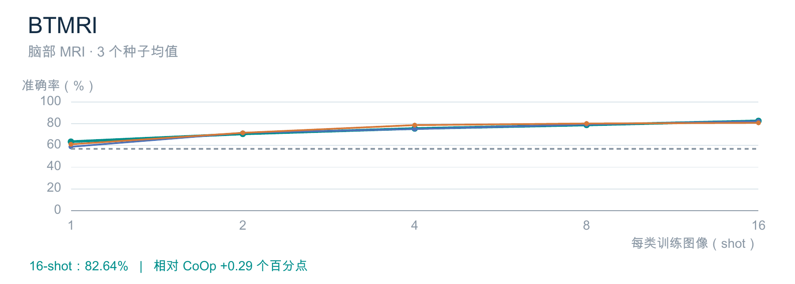

BTMRI 的三种有标签方法总体随标签增加而改善，说明增加支持图像能够帮助当前分类任务。在 16-shot 下，两种提示方法的均值较为接近，BiomedCoOp 略高于 CoOp。不同 shot 下的排序并不完全一致，因此这组结果更适合描述整体学习趋势，而不宜概括为每个标签预算下都领先。

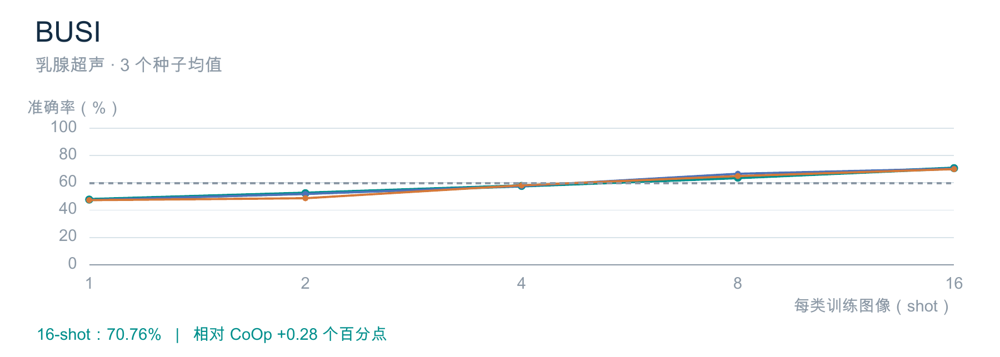

BUSI 在低 shot 下出现了有标签方法低于零样本的情况，增加少量标签并未立即带来更高准确率。随着支持图像增多，各方法逐渐改善，并在较高 shot 下超过零样本。这个现象提醒我们，少样本适应的效果需要实际评估，不能仅根据是否使用了训练标签作出判断。

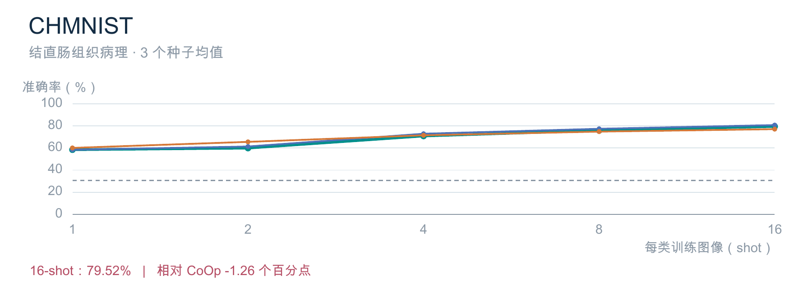

CHMNIST 的有标签方法在高 shot 下明显高于零样本，提示学习与线性探针都能从新增标签中受益。在 16-shot 下，CoOp 的均值高于 BiomedCoOp，表明额外的医学提示约束没有在该设置下带来更高准确率。这一结果与其他数据集上的正收益共同说明，方法表现受具体分类任务影响。

### 5.2 胸部 X 光、肾脏 CT 与皮肤镜

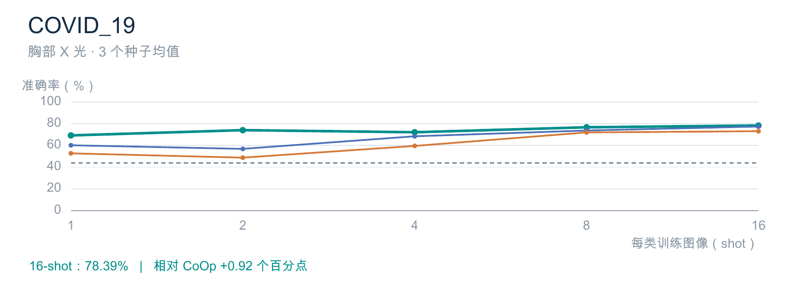

COVID_19 上，BiomedCoOp 在低 shot 下与两种有标签对照拉开了较明显的差距，体现出该数据集上的少标签收益。不过，BiomedCoOp 从 2-shot 到 4-shot 出现了回落，曲线并非逐点单调上升。到 16-shot 时其均值仍高于对照，但后期差距已小于部分低 shot 设置。

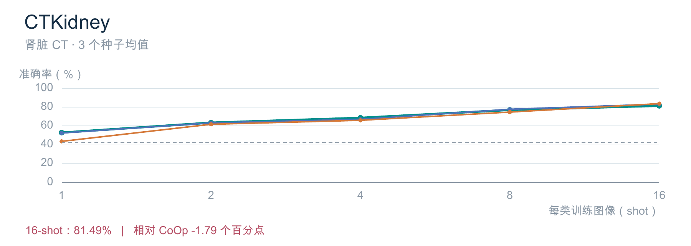

CTKidney 的三种有标签方法都随标签数量增加而整体改善，早期两种提示方法的结果较为接近。在 16-shot 下，线性探针和 CoOp 的均值均高于 BiomedCoOp。该结果说明，冻结特征上的简单分类器在部分任务中也具有竞争力，应与提示学习方法一并保留比较。

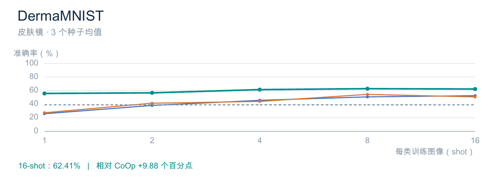

DermaMNIST 是本次正收益较突出的数据集，BiomedCoOp 在少标签阶段就与 CoOp 拉开了距离。随着标签增加，两种对照方法有所追近，但在 16-shot 下仍低于 BiomedCoOp。与此同时，BiomedCoOp 后期曲线趋于平缓，增加标签带来的收益并未持续保持早期的幅度。

### 5.3 膝关节 X 光、消化道内镜与肺结肠组织病理

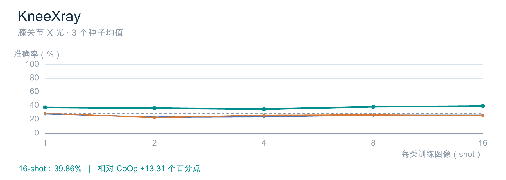

KneeXray 上，BiomedCoOp 在各个 shot 档位都保持了相对优势，是总体差值图中较突出的正收益来源。不过，三种有标签方法的绝对准确率都不高，BiomedCoOp 也未随标签增多呈现明显的持续跃升。阅读这一结果时，应同时保留“相对对照更好”和“当前任务仍较困难”这两个观察。

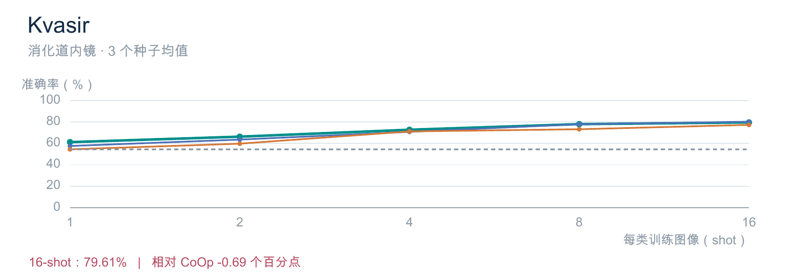

Kvasir 上，BiomedCoOp 在较低 shot 下具有一定优势，随后两种提示方法的曲线逐渐靠近。在 16-shot 下，CoOp 的均值略高于 BiomedCoOp，而线性探针低于两种提示方法。整体上看，各方法都从增加标签中受益，但后期的均值差距较小，需要结合种子波动审慎理解。

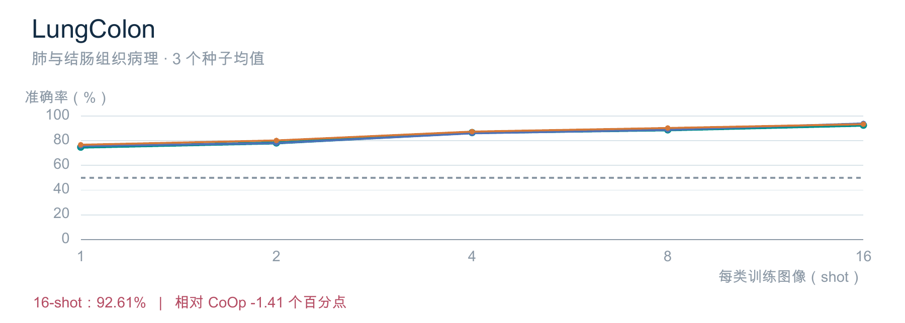

LungColon 在高 shot 下取得了较高的测试准确率，三种有标签方法的曲线也较为接近。在 16-shot 下，CoOp 的均值高于 BiomedCoOp，线性探针同样保持了较强表现。这个数据集体现了另一类情况：当多种方法都能较好地利用基础表示时，医学提示方法未必获得额外优势。

### 5.4 视网膜 OCT 与眼底照片

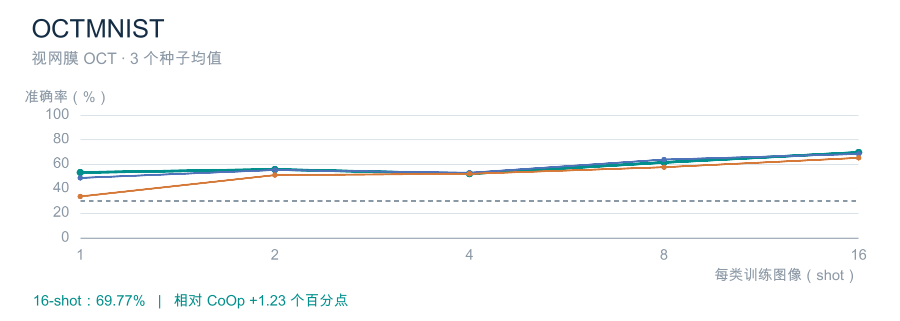

OCTMNIST 的曲线存在回落和波动，增加标签并没有在每个档位上都带来更高均值。到 16-shot 时，BiomedCoOp 的平均准确率略高于 CoOp 和线性探针。结合后文的种子结果可以看到，该数据集仍存在一定实验波动，单个均值点不足以完整描述方法表现。

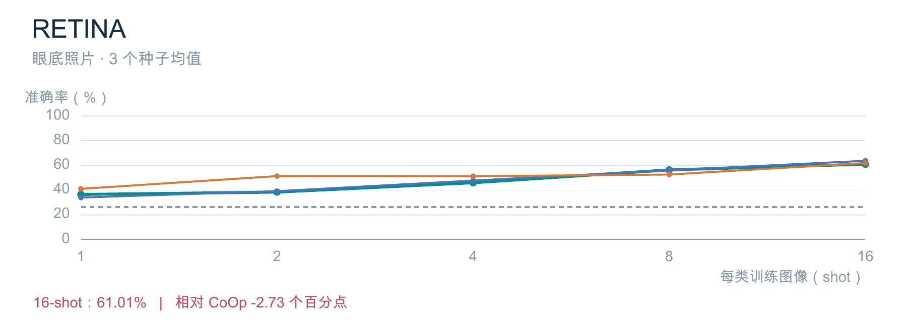

RETINA 上，线性探针在多个低 shot 点高于两种提示方法，说明现有冻结视觉特征对该分类任务仍然有用。随着标签增加，两种提示方法的准确率逐步提高，但在 16-shot 下 CoOp 高于 BiomedCoOp。这一结果与 OCTMNIST 的排序不同，因此不能把同属眼科影像的数据集视为具有完全相同的迁移表现。

## 六、随机波动、训练过程与测试错误

### 6.1 三个种子呈现的结果范围

总体均值压缩了信息，但同一方法在不同支持集采样与训练随机状态下仍会发生变化。下图直接展示 16-shot 的三个种子结果，让读者看到均值背后的分布范围。部分方法之间的点比较接近，解释这些差异时，需要同时考虑本次实验中的随机波动。

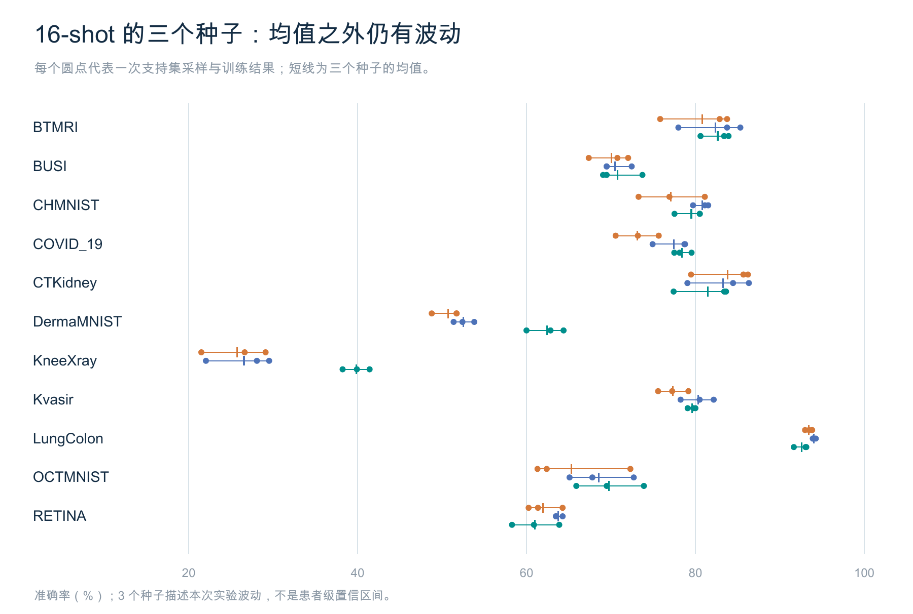

*图 21｜圆点代表单个种子结果，短线代表三个种子的均值，颜色与前文一致。*

本次的三个种子用于描述支持集采样和训练随机性下的重复实验表现，没有进行显著性检验。种子数量也不能换算为独立患者数量，其波动范围并非患者级置信区间。因此，总体均值、分数据集曲线和种子结果应结合阅读，共同限定本次结论的范围。

### 6.2 从训练历史观察优化过程

以 BTMRI 的 16-shot、seed 1 为例，两种提示方法都记录了完整的 100 轮训练历史。曲线显示训练目标在早期下降较快，后续继续变化并伴随波动，可以用于观察优化过程是否持续推进。但两种方法的目标函数构成不同，图中的纵轴也分别缩放，损失绝对值不能直接用来比较最终方法优劣。

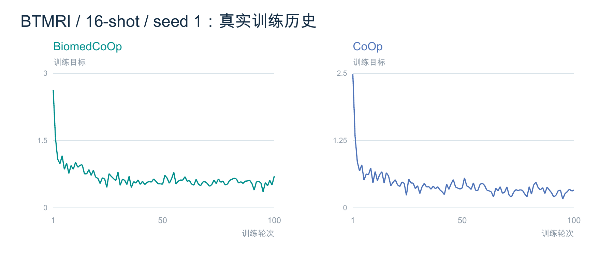

*图 22｜实际记录的训练目标，设置为 BTMRI、16-shot、seed 1。*

### 6.3 完整测试集上的类别混淆

训练目标反映优化过程，混淆矩阵则直接展示测试图像的分类去向。下图由同一 BiomedCoOp 运行的完整 1,717 张 BTMRI 测试预测重新计数，行表示公开真实类别，列表示模型预测类别。对角线以外的单元格揭示了类别之间的混淆，也为后面的错误样例提供了完整测试集背景。

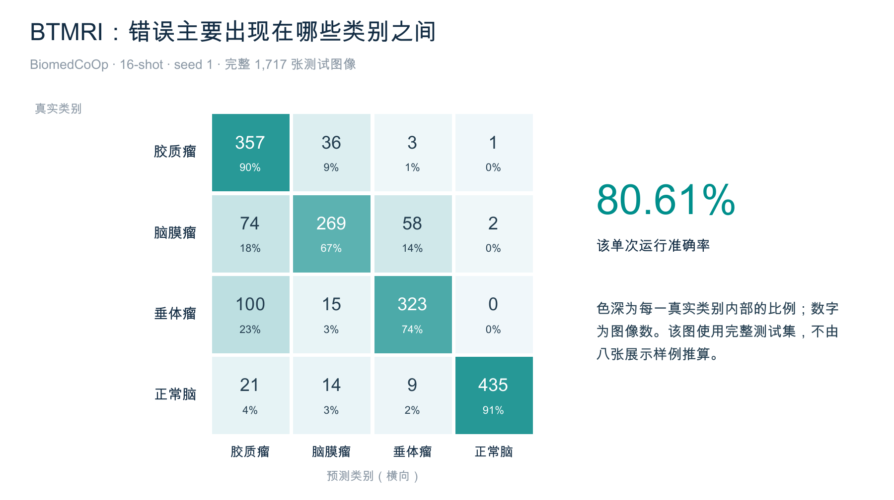

*图 23｜单元格数字为图像数，百分比按真实类别归一化；该图未由展示样例推算。*

该单次运行的准确率为 80.61%，与前文 BTMRI 的三个种子平均结果属于不同统计口径。矩阵中仍可见多种类别混淆，说明较高的总体准确率并不意味着每一类图像都具有相同的识别效果。因此，后续展示具体错误时，需要保留其运行设置和选择方式，避免用少量图片替代完整测试结果。

## 七、真实 MRI 图集与错误样例解读

### 7.1 样例从哪里来，能够说明什么

本节使用已发布的 BTMRI 测试图像，展示 BiomedCoOp 在 16-shot、seed 1 下按作者测试顺序出现的前八个错误。这些图片均为真实公开影像，其公开标签都是胶质瘤，卡片同时标出了模型预测类别及相应分类分数。由于样例按错误顺序选取，它们不代表随机病例分布，也不能据此计算整个数据集的错误比例。

*图 24｜前八个错误样例，原图仅作等比缩放，未生成或合成医学影像。*

展示错误样例有助于把平均准确率转化为可直接观察的模型行为，但图像本身不足以解释错误产生的医学原因。本项目没有取得这些图像的患者级身份信息，也没有对公开标签进行临床复核。因此，以下解读只讨论模型输出与公开标签的关系，不对影像作病灶定位、病理解释或诊疗推断。

### 7.2 高分类分数与接近的类别分数

样例 02 中，模型对脑膜瘤给出了约 87.2% 的分类分数，但公开标签为胶质瘤。模型在这一张图像上的输出较为集中，最终预测仍与标签不一致。这说明较高的分类分数并不能保证分类正确，也不能直接将其解释为经过校准的临床诊断概率。

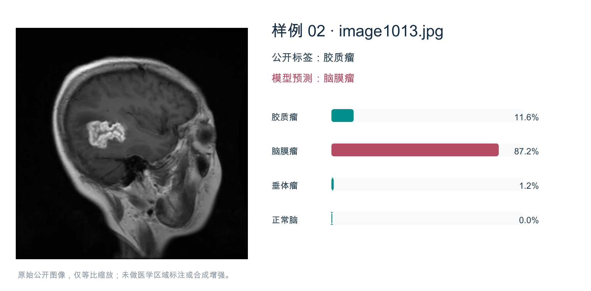

*图 25｜高分数错误样例：公开标签为胶质瘤，模型预测为脑膜瘤。*

样例 08 中，模型对垂体瘤给出了约 48.3% 的分数，与胶质瘤对应分数较为接近，最终仍选择了与公开标签不一致的类别。它与样例 02 同为分类错误，但输出分布的形态并不相同。将两种错误放在一起，可以看到平均准确率没有呈现的细节，同时也提示分类分数需要结合具体输出分布理解。

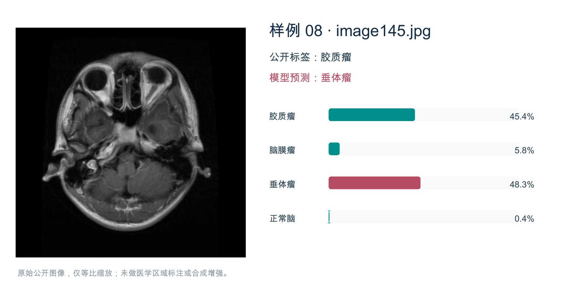

*图 26｜类别分数较接近的错误样例：公开标签为胶质瘤，模型预测为垂体瘤。*

## 八、复现可靠性、实现差异与结论

### 8.1 结果如何与实验记录对应

全部正式主实验于 2026 年 10 月 16 日 06:49 完成，完成记录、逐例预测、共享支持集和训练历史均已核验。每一项结果都能对应到相应的数据集、方法、shot 和种子，报告中的公开 MRI 示例也保留了原图来源。本次仅对既有结果作图文整理与段落修订，没有新增训练或补充实验。

*图 27｜完成配置、预测指标、共享支持、训练历史与公开示例之间的证据关系。*

实验使用 Tesla T4 和 FP32，部分运行设置根据设备条件进行了调整。公开 CoOp 配置的 batch 从 32 改为 4，保留学习率 0.002；BiomedCoOp 使用学习率 0.0025，测试 batch 与 worker 分别为 16 和 2。线性探针修复了公开采样入口并统一支持集，这些差异均随完整实验记录保留，理解与原文的对应关系时需要一并考虑。

标签预算还需要与实际训练访问区分开来：支持集包含每类 K 张图像，但不足一个 batch 的尾部可能被丢弃。例如，LungColon 的 1/2-shot 每轮实际访问 4/8 张图像，不能写成每轮完整遍历全部 5/10 张。这不会改变已保存的支持集清单，但会影响对每轮训练规模的描述，因此报告保留了这一细节。

### 8.2 本次复现支持的结论

综合完整主实验，BiomedCoOp 在本次少标签医学图像分类设置中取得了较好的跨数据集平均表现，其优势在低 shot 的总体比较中更为明显。不过，各数据集的收益幅度、方法排序和随机波动并不一致，真实 MRI 示例中也保留了高分数预测错误。因而，结论应限定在本次公开分类基准与协议之内，并结合分项结果理解。

原文 16-shot 总体参考值为 72.42%，本次为 72.55%，两者在汇总数值上较为接近。由于协议与运行环境存在上述差异，数值接近不能替代逐项复现分析，更不能证明临床效能。当前仍未知患者独立性与预训练数据重叠情况，也没有验证临床 AAS 场景，这些都是将结果用于其他任务时需要保留的限制。

本报告保留了 26 幅重新整理的图形、1 幅作者方法图，以及 8 张真实公开 MRI 原图，部分案例图对同一原图作了更详细的输出分布解读。正文精简了原始大表格，将数据覆盖、方法过程、主要结果和错误观察组织为连续叙述。完整逐次指标、预测与审计证据继续保存在原完整主实验交付中，可用于追溯图中的具体结果。

## 九、仓库内的配套材料

- [原始主实验报告与完整结果表](results/BiomedCoOp完整主实验复现报告.md)。
- [506项逐配置指标](results/per-run-metrics.csv)、[165行三种子汇总](results/summary-metrics.csv)、[标签预算](results/label-budgets.csv)。
- [330份训练曲线CSV](results/curves/)、[165份跨方法共享支持集](results/supports/)。
- [BTMRI单次测试预测与运行记录](results/case-run/)、[8张原始图像及追溯表](results/displayed-example-image-provenance.csv)。
- [实际运行代码](code/)、[实验运行工具](tools/)、[冻结计划](protocol/plan.json)、[完成核验](evidence/delivery-proof.json)。
- [本次归档范围与文件SHA](文件清单.json)。

本次仓库整理保留报告相关结果、全部配置的完成元数据、曲线与支持集，并附图文案例对应的完整BTMRI单次预测；未重复收录全部506项逐例预测及原始attempt日志。全量原始记录仍保存在原主实验交付目录。本目录不含完整数据集、基础模型或训练权重，重新训练需按固定来源另行准备。
